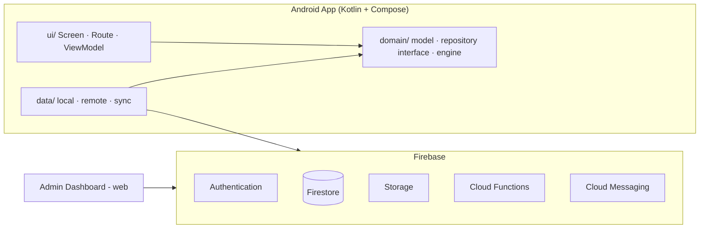

# UTH Connect — Design Document

> **Tên sản phẩm:** *UTH Connect* — thống nhất theo `rootProject.name`, `applicationId = com.giathinh.uthconnect` và `app_name` trong `res/values/strings.xml`. Tên cũ *UTH Campus* / *CampusHub* không dùng trong code, tài liệu hay UI.
> **Nền tảng:** Android (Kotlin, Jetpack Compose) + Firebase + Admin Dashboard (web)
> Tài liệu này mô tả **cái gì** và **vì sao**.

**Bộ tài liệu và quyền ưu tiên khi mâu thuẫn**

| File | Chứa | Thắng khi mâu thuẫn về |
|---|---|---|
| `Design.md` (tài liệu này) | phạm vi, vai trò, luồng nghiệp vụ, dữ liệu, bảo mật, NFR, rủi ro | phạm vi & nghiệp vụ |
| `Design-system.md` | token màu/chữ/spacing, component, dark mode, accessibility | giao diện |
| `README.md` | spec chi tiết từng module (API, tiêu chí nghiệm thu, wireframe), roadmap, metrics, contributing | không quyết định scope |
| `docs/GIT_WORKFLOW.md` | nhánh, quyền push, mẫu commit, quy trình review cho nhóm 6 người | quy trình Git |
| `CODING_STANDARDS.md` | quy ước code: đặt tên, ranh giới tầng, Kotlin/Compose style, coroutines, test, lệnh kiểm tra | cách viết code |
| `REPO_TREE.md` | cây thư mục đang có, mỗi người sở hữu package nào, file chung sửa ra sao, nghi thức gộp cây | cấu trúc thư mục & quyền sở hữu file |

---

## 1. Tổng quan

### 1.1. Vấn đề
Sinh viên UTH đang dùng Facebook, Zalo, Google Sheet và giấy tờ rời rạc cho những việc rất cụ thể của trường: đăng ký/điểm danh sự kiện CLB, nhớ lịch học và deadline, tìm trọ, tìm đồ thất lạc, đi chung xe. Các nền tảng này quá rộng, thiếu xác thực "đúng sinh viên UTH" và không có số liệu cho ban tổ chức.

### 1.2. Mục tiêu
- Một app **hẹp nhưng dùng thật** cho cộng đồng UTH, thay cho bản "mạng xã hội đa năng" cũ (tin tức đại trà, thể thao, giải trí đã bị loại bỏ vì trùng với app báo có sẵn).
- Mọi tài khoản đều **xác thực là sinh viên/giảng viên UTH**.
- Có **admin dashboard** để duyệt nội dung, quản lý báo cáo và xem thống kê (điểm nhấn khi demo với doanh nghiệp).

### 1.3. Ngoài phạm vi (Non-goals)
- Không làm tin tức tổng hợp, không làm feed mạng xã hội kiểu Facebook.
- Không xử lý thanh toán trong app ở giai đoạn đầu.
- **Không tích hợp API hệ thống đào tạo của trường**: chỉ nhập tay hoặc import từ ảnh/PDF do người dùng cung cấp (khác với "kết nối cổng thông tin điện tử").
- Không làm iOS trong học kì này.

---

## 2. Người dùng & vai trò

| Vai trò | Mô tả | Quyền chính |
|---|---|---|
| **Student** | Sinh viên UTH | Xem/đăng ký sự kiện, dùng các module, đăng bài trong module |
| **Organizer** | Người đại diện CLB/đoàn hội | Tạo sự kiện, quét QR điểm danh, xem thống kê sự kiện của mình |
| **Admin** | Quản trị hệ thống | Duyệt Organizer, kiểm duyệt nội dung, xem báo cáo, khóa tài khoản |

Vai trò lưu bằng **Firebase custom claims** (không tin dữ liệu role do client gửi, và **không** lấy role từ một tài liệu Firestore mà client có thể sửa). Claims chỉ được ghi bởi Cloud Function/Admin SDK sau khi Admin duyệt.

---

## 3. Phạm vi sản phẩm & Roadmap

Ứng dụng chia thành các **module độc lập** (feature module), cùng dùng chung Auth, Profile, Notification, Design System.

Ghi chú nhãn: `Design.md` (file này) là nguồn của **thứ tự giai đoạn**; `README.md` mục 3 mô tả chi tiết bài toán/API/tiêu chí nghiệm thu cho từng module và dùng cùng nhãn P0–P2 như bảng dưới.

| Giai đoạn | Module | Nhãn trong `README.md` | Mục tiêu | Ghi chú |
|---|---|---|---|---|
| **MVP (Phase 1)** | Auth + Profile (xác thực UTH) | 3.1 nền | Nền tảng cho mọi thứ | Bắt buộc |
| | **Sự kiện / CLB + QR check-in** | 3.1 `P0` | Module lõi để demo | Xem mục 4 |
| | Admin Dashboard (duyệt Organizer, xem thống kê) | — | Có sản phẩm "doanh nghiệp" | |
| **Phase 2** | Thời khóa biểu + Deadline tracker + nhóm học chung | 3.3 `P1` | Dùng hằng ngày | Nhắc lịch bằng local notification (`WorkManager`) |
| **Phase 3** | Đồ thất lạc (Lost & Found) | 3.4 `P1` | Nhỏ, demo trực quan | Ảnh + vị trí trong khuôn viên |
| **Backlog** | Ghép trọ / bạn ở ghép | 3.2 `P2` | Cần xác thực và kiểm duyệt kỹ | Rủi ro nội dung cao |
| | Chợ sách/giáo trình cũ + chat (từ bản cũ) | 3.6 `P2` | Có thể port lại từ repo cũ | Dùng chung listing engine với ghép trọ |
| | Ghép xe đi chung | 3.5 `P2` | Cần cân nhắc an toàn người dùng | |

> **Nguyên tắc:** chỉ bắt đầu module kế tiếp khi module trước đã đạt Definition of Done (mục 10). Module nào đang làm dở mà trễ milestone thì cắt bớt tính năng trong module đó, **không** mở thêm module mới.

---

## 4. Module lõi (MVP): Sự kiện / CLB + QR check-in

### 4.1. User stories
**Student**
- Xem danh sách sự kiện sắp diễn ra, lọc theo CLB/thời gian.
- Đăng ký / hủy đăng ký sự kiện (có giới hạn số lượng).
- Nhận nhắc nhở trước giờ diễn ra.
- Mở **vé QR** của mình để check-in.
- Xem lịch sử tham gia.

**Organizer**
- Tạo/sửa/hủy sự kiện (tên, mô tả, địa điểm, thời gian, số lượng, ảnh bìa).
- Xem danh sách đăng ký.
- Quét QR của sinh viên để điểm danh, xem kết quả ngay (hợp lệ / trùng / hết hạn / chưa đăng ký).
- Xuất thống kê tham gia (CSV).

**Admin**
- Duyệt yêu cầu trở thành Organizer, ẩn/xóa sự kiện vi phạm.

### 4.2. Luồng check-in (quyết định thiết kế)
1. Student mở vé của sự kiện → app xin một **token ngắn hạn** từ backend.
2. Token chứa `eventId`, `uid`, thời điểm hết hạn (≈ 60 giây), được **ký ở server** (Cloud Function). App hiển thị token dưới dạng QR và tự làm mới.
3. Organizer quét QR bằng app → gửi token lên callable function `checkIn`.
4. Server kiểm tra: chữ ký, hạn dùng, sinh viên đã đăng ký, chưa check-in, sự kiện đang trong khung giờ cho phép → ghi bản ghi `attendance`.
5. Trả kết quả cho Organizer; giao diện kết quả theo `Design-system.md` mục 4.7 (màu + icon + haptic).

**Vì sao dùng QR động phía sinh viên:** chống chụp màn hình gửi cho bạn điểm danh hộ. Kiểm tra hoàn toàn ở server nên client không thể tự "ghi" điểm danh.

**Phương án dự phòng (bắt buộc phải có vì mục 11):** nếu chưa chốt được gói Blaze cho Cloud Functions, MVP chạy **QR tĩnh** chứa `ticketId` + mã 6 số nhập tay, việc chống quét trùng vẫn nằm trong transaction phía server; chỉ khác là mất khả năng chống chụp màn hình. Điều này phải ghi rõ khi demo, không âm thầm đổi.

### 4.3. Trường hợp biên cần xử lý
- Mất mạng ở cửa vào: Organizer có chế độ xếp hàng quét (queue) và đồng bộ lại; token vẫn kiểm tra được khi có mạng.
- Quét trùng hai lần → báo "đã điểm danh", không ghi thêm.
- Sự kiện bị hủy/đổi giờ sau khi đã đăng ký → thông báo cho người đã đăng ký.
- Đăng ký vượt số lượng (race condition) → dùng transaction phía server.
- Lệch đồng hồ thiết bị → mọi so sánh thời gian dựa trên **server time**.
- Camera bị từ chối quyền → fallback nhập mã 6 số (luồng không bị bế tắc).
- QR in trên giấy/vải cho sự kiện không cần đăng ký trước → tách sang chế độ "check-in mở", không bắt buộc có `registration`.

---

## 5. Kiến trúc

### 5.1. Tổng thể



- **Clean Architecture + Feature Packaging** (cấu trúc package đã dựng ở mục 5.1.1; cấu trúc Gradle đa module đích ở `README.md` mục 7.2; quy ước code chi tiết ở `CODING_STANDARDS.md` mục 3).
- **MVVM + UDF đã dựng sườn và có slice mẫu:** tab Tiện ích đi đủ một chiều `UiState → Screen → Action → ViewModel → UseCase → Repository` (`presentation/utilities/`), ViewModel do **Hilt** dựng. Các module khác làm theo đúng 5 file của slice đó.
- **UDF:** Screen nhận `UiState`, phát `Action`; ViewModel giữ trạng thái. Screen **không** gọi repository.
- **Offline-first ở mức vừa đủ:** Room làm cache cho danh sách đã xem và thời khóa biểu; Firestore persistence cho dữ liệu cần offline.

### 5.2. Tech stack

| Lớp | Công nghệ |
|---|---|
| UI | Jetpack Compose, Material 3, Navigation Compose **type-safe** (`composable<T>`) |
| DI | Hilt `2.60.1` + KSP `2.3.12` — **đã vào code** (`@HiltAndroidApp` · `@AndroidEntryPoint` · `@Binds` · `@HiltViewModel`) |
| Serialization | Kotlin serialization plugin (`2.2.10`) + `kotlinx-serialization-json 1.9.0` — **đã vào code** cho route `@Serializable` |
| Async | Kotlin Coroutines + Flow |
| Local | Room, DataStore |
| Backend | Firebase Auth, Firestore, Storage, Cloud Functions, FCM |
| Quét / tạo QR | CameraX + ML Kit Barcode Scanning; ZXing cho phía sinh mã vé |
| Test | JUnit, MockK, Turbine, Compose UI Test, Firebase Emulator Suite |
| Crash & hiệu năng | Firebase Crashlytics, Macrobenchmark (cold start) |
| CI | GitHub Actions (build, lint, unit test) |

> **Lưu ý chi phí:** Cloud Functions yêu cầu gói Blaze của Firebase. Cần xác nhận phương án thanh toán trước khi chốt luồng check-in; nếu không dùng được, áp dụng phương án dự phòng ở mục 4.2.

Bảng đối chiếu phiên bản đang thực sự khai trong code: `README.md` mục 5.3 (AGP 9.3.3, Kotlin 2.2.10, Compose BOM 2026.02.01, Navigation Compose 2.10.2 + kotlinx-serialization-json 1.9.0, **compileSdk 37.1** / targetSdk 36 / minSdk 31). compileSdk phải nâng lên 37.1 vì core-ktx 1.19.1, lifecycle 2.11.0 và navigation-compose 2.10.2 đều đòi AAR metadata "compile against version 37 or later".

### 5.1.1. Cấu trúc package đã dựng (`app/src/main/java/com/giathinh/uthconnect/`)

```
com/giathinh/uthconnect/
├── MainActivity.kt                  # single activity, @AndroidEntryPoint — điểm vào DI
├── UTHConnectApplication.kt         # @HiltAndroidApp — gốc của SingletonComponent
├── core/
│   └── designsystem/
│       ├── theme/                   # Color.kt · Type.kt · Dimens.kt · Theme.kt
│       └── component/               # UthComponents.kt · UthStatusBadge.kt
├── data/
│   ├── repository/                  # implementation thật (repository, remote, local)
│   └── di/                          # <Module>DataModule.kt — @Binds của riêng từng module
├── domain/
│   ├── model/                       # data class thuần Kotlin, không import Android
│   ├── repository/                  # interface — UI không biết implementation
│   └── usecase/                     # một nghiệp vụ một file, `@Inject constructor`, `suspend` + `Result<T>`
└── presentation/
    ├── navigation/                  # UthDestination.kt (4 tab) · UthApp.kt (Scaffold + NavHost)
    └── home/ · schedule/ · utilities/ · profile/
```

**Sườn một module trong `presentation/<module>/`** — `utilities/` đang có đủ 5 file, các module khác copy nguyên cấu trúc:

| File | Vai trò | Ràng buộc |
|---|---|---|
| `<Module>Screen.kt` | render `UiState`, phát `Action` | stateless; không `hiltViewModel()`, không repository |
| `<Module>Route.kt` | nối ViewModel với Screen | chỗ duy nhất chạm `hiltViewModel()`; NavHost gọi file này |
| `<Module>ViewModel.kt` | `@HiltViewModel` + `@Inject constructor`, giữ `StateFlow<UiState>`, điều phối UseCase | không `Context`/`Modifier`/`@StringRes`; `_uiState` private |
| `<Module>UiState.kt` | data class bất biến, mặc định = trạng thái an toàn | loading ≠ empty; thất bại bằng enum, không bằng chuỗi |
| `<Module>Action.kt` | sealed interface ý định người dùng | không chứa dẫn đường giữa các tab |

Không còn file factory: `AppContainer` + `CompositionLocal` DI + `ViewModelFactory` đã bị xoá khi chuyển sang Hilt. Binding interface→impl nằm trong `data/di/<Module>DataModule.kt` của chính module (`@Binds`), UseCase chỉ cần `@Inject constructor`.

**Chiều phụ thuộc bắt buộc:** `presentation → domain ← data`, và trong `presentation`: `Route → ViewModel → UseCase`. `domain` không import `androidx` (chỉ thêm `javax.inject`), không biết Firestore; `presentation` chỉ biết interface trong `domain/repository`.

Một màn hình mới cần có: (1) model + repository interface + use case (`@Inject constructor`) ở `domain`, (2) implementation + datasource ở `data`, (3) bộ 5 file `Screen/Route/ViewModel/UiState/Action` trong `presentation/<module>/`, (4) `data/di/<Module>DataModule.kt` với `@Binds` nếu có interface repository — **không** đăng ký ở file DI chung nào, (5) unit test ViewModel theo mẫu `UtilitiesViewModelTest` (new trực tiếp bằng fake, không cần rule Hilt) + `@Preview` đủ 4 trạng thái light/dark, (6) token/component dùng lại từ `core/designsystem` — không tự khai màu/`.dp` riêng.

Phạm vi file từng người được tạo/sửa: `REPO_TREE.md` mục 3–5.

### 5.3. Xác thực "là người UTH"
- Đăng nhập bằng email trường (tên miền do trường cấp) và xác minh email.
- Kiểm tra tên miền ở **server** (blocking function hoặc security rule), không chỉ ở client.
- Chi tiết tên miền/quy tắc cụ thể: *cần xác nhận với trung tâm quản lý email của trường*.
- **Fallback khi trường không cấp email:** duyệt tay bằng mã số sinh viên trong Admin Dashboard (xem mục 11).

---

## 6. Mô hình dữ liệu (Firestore)

```
users/{uid}
  displayName, studentId?, faculty, avatarUrl, createdAt
  (role nằm trong custom claims, không lưu để client sửa)

organizers/{orgId}
  name, description, logoUrl, ownerUid, status(pending|approved|rejected)

events/{eventId}
  orgId, title, description, location, startAt, endAt
  capacity, registeredCount, status(draft|published|cancelled), coverUrl

events/{eventId}/registrations/{uid}
  registeredAt, status(registered|cancelled)

events/{eventId}/attendance/{uid}
  checkedInAt, checkedInBy

reports/{reportId}
  targetType, targetId, reason, reporterUid, status
```

**Mở rộng cho Phase 2/Backlog** (chi tiết ở `README.md` mục 3 và 6):

```
courses/{courseId}, deadlines/{id}          # Phase 2 — Room là source of truth, cloud là bản sao
lostFound/{id}                              # Phase 3
listings/{listingId}  kind(room|book)       # Backlog — ghép trọ và chợ sách dùng chung
trips/{tripId}                              # Backlog — có semantics ghế/lịch trình nên tách khỏi listings
```

Nguyên tắc:
- Dữ liệu đếm (`registeredCount`) chỉ cập nhật bằng transaction/function.
- `attendance` **chỉ** ghi được từ Cloud Function.
- Subcollection theo `events/{eventId}` để một sự kiện không cần scan toàn collection; nếu về sau cần query "mọi sự kiện của một sinh viên" thì mới thêm collection phẳng `registrations` kèm chỉ mục.
- Index khai báo trong `firestore.indexes.json` và commit vào repo.

---

## 7. Bảo mật & Quyền riêng tư

- **Firestore Security Rules** viết theo nguyên tắc từ chối mặc định, có **test bằng Emulator** cho từng collection.
- Student chỉ đọc/ghi hồ sơ và đăng ký của chính mình.
- Organizer chỉ sửa sự kiện thuộc tổ chức đã được duyệt của mình.
- Không lưu mật khẩu, khóa bí mật hay `google-services.json` thật trong repo công khai (dùng file mẫu và CI secrets).
- Chỉ thu thập dữ liệu tối thiểu; ảnh và vị trí (ở các module sau) cần xin quyền runtime rõ ràng.
- Có chức năng **báo cáo nội dung** và quy trình xử lý trong Admin Dashboard.
- Ảnh giấy tờ trong Lost & Found: làm mờ số CCCD/tên trước khi cho phép đăng.

---

## 8. Bản đồ màn hình

### 8.1. Khung 4 tab đã dựng (`presentation/navigation/`)

```
Trang chủ      → HomeDestination     → nội dung module Sự kiện (MVP)
Thời khóa biểu → ScheduleDestination → placeholder Phase 2
Tiện ích       → UtilitiesDestination → danh sách module + badge giai đoạn
Cá nhân        → ProfileDestination  → đăng nhập/xác thực + vé + cài đặt
```

Route là **type-safe**: 4 destination là `@Serializable object` (không tham số), không còn chuỗi phẳng. NavHost đăng ký bằng `composable<T>`, chọn tab dùng `popUpTo(start) + saveState/restoreState + launchSingleTop` để mỗi tab giữ trạng thái riêng và không xếp chồng bản sao. Tab đang chọn suy ra bằng `NavDestination.hasRoute(T::class)` từ `currentBackStackEntry`, không so chuỗi và không nhân bản sang biến state riêng.

Trạng thái theo từng tab so với sườn MVVM mục 5.1.1:

| Tab | Đã có | Còn thiếu |
|---|---|---|
| Tiện ích | đủ 5 file MVVM + 4 test (`UtilitiesViewModelTest`) | graph con bên trong module; nối Firebase thật |
| Trang chủ | Screen stateless + placeholder sự kiện | `HomeViewModel` + `HomeUiState` khi module Sự kiện vào code |
| Thời khóa biểu | Screen placeholder Phase 2 | cả 5 file, do `feature/timetable-<tên>` dựng |
| Cá nhân | Screen placeholder đăng nhập | `ProfileViewModel` + luồng auth (M0) |

### 8.2. Màn hình nghiệp vụ khi module vào code

```
Auth (chưa dựng):        Welcome → Login / Register → Verify Email
Trong tab Trang chủ:    EventList → EventDetail → Register
Trong tab Cá nhân:      MyTickets → TicketQr (QR động)
Trong tab Cá nhân*:     OrganizerEvents → EventEditor → AttendanceScanner → EventStats
Trong tab Cá nhân:      Profile → Settings (ngôn ngữ EN/VI, giao diện)
Trong tab Tiện ích:    LostFound · Books · Housing · RideShare (mở dần theo giai đoạn)
(*) chỉ hiện với Organizer
```

Wireframe từng màn hình: `README.md` mục 4. Giao diện tuân theo `Design-system.md`; Figma là nguồn tham chiếu cho bố cục, **không** được override các token tương phản đã đo.

---

## 9. Yêu cầu phi chức năng

- **Hiệu năng:** màn hình danh sách hiển thị dữ liệu cache dưới 1 giây khi mở lại; phân trang danh sách; cold start p90 ≤ 2 s.
- **Độ tin cậy:** check-in có phản hồi rõ ràng trong 2 giây ở điều kiện mạng bình thường; crash-free sessions ≥ 99.5 %.
- **Khả năng tiếp cận:** theo `Design-system.md` mục 6 — touch target ≥ 48.dp, TalkBack, font scale tới 200 %, không truyền trạng thái chỉ bằng màu.
- **Đa ngôn ngữ:** Tiếng Việt (mặc định) và Tiếng Anh; mọi chuỗi nằm trong `res/values{,-en}/strings.xml`.
- **Hỗ trợ thiết bị:** `minSdk = 31` (Android 12) như `app/build.gradle.kts`; compileSdk 37.1, targetSdk 36. Muốn hỗ trợ Android 8–11 phải hạ `minSdk` có chủ đích và kiểm thử lại quyền camera/thông báo.

---

## 10. Kiểm thử & Phát hành

- **Definition of Done** cho một tính năng: TODO checklist hoàn tất; unit test cho logic nghiệp vụ pass; `@Preview` cho màn hình ở loading/empty/error + light/dark; chuỗi EN/VI đầy đủ; security rules + test cập nhật nếu đụng dữ liệu; build CI xanh.
- **Nhánh:** `main` luôn build được; làm việc trên `feature/<module>-<tên>` theo `docs/GIT_WORKFLOW.md`, merge bằng Pull Request có review. Không push thẳng vào `main`/`develop`.
- **Build cục bộ trên máy RAM thấp:** nếu Kotlin daemon báo "paging file is too small", chạy `gradlew :app:assembleDebug "-Pkotlin.compiler.execution.strategy=in-process"`.
- **Phát hành:** APK debug/release đính kèm GitHub Releases cho giảng viên cài thử; có thể thêm Firebase App Distribution.

---

## 11. Rủi ro & phương án

| Rủi ro | Mức | Giảm thiểu |
|---|---|---|
| Phạm vi phình to (bài học từ bản cũ) | Cao | Làm theo roadmap mục 3, chỉ mở module mới khi module trước đạt DoD |
| Cloud Functions cần gói Blaze | Trung bình | Xác nhận sớm; fallback QR tĩnh + mã 6 số (mục 4.2) |
| Khó có người dùng thật để demo | Trung bình | Hợp tác 1–2 CLB chạy thử một sự kiện thật |
| Nội dung vi phạm (module trọ, xe) | Cao | Để backlog, cần kiểm duyệt + xác thực trước khi mở |
| Không có email trường để xác thực | Trung bình | Duyệt tay qua mã số sinh viên trong dashboard |
| Thiết bị cũ không tương thích API 31 | Thấp | Thống kê thiết bị của nhóm thí sinh trước khi chốt minSdk |

---

## 12. Câu hỏi còn mở

1. Chốt **module MVP** là Sự kiện/CLB + QR check-in — **đã chốt** (mục 4); nếu đổi phải cập nhật cả `README.md`.
2. Có dùng được email trường để xác thực không, tên miền cụ thể là gì?
3. Phân công 6 người trong nhóm (bạn + 5 bạn): mỗi người một `feature/<module>-<tên>`; module nào cho ai, thời gian học kì doanh nghiệp còn lại bao nhiêu (để cắt phạm vi cho vừa).
4. Admin Dashboard trong repo cũ dùng công nghệ nào, giữ lại hay viết mới?
5. Có CLB nào sẵn sàng làm đối tác chạy thử không?
6. Chốt gói Blaze cho Cloud Functions (quyết định QR động hay phương án dự phòng mục 4.2)?
7. Font Roboto hay Inter; giữ brand `#4F46E5` hay theo nhận diện Đoàn–Hội (xem `Design-system.md` mục 10)?
