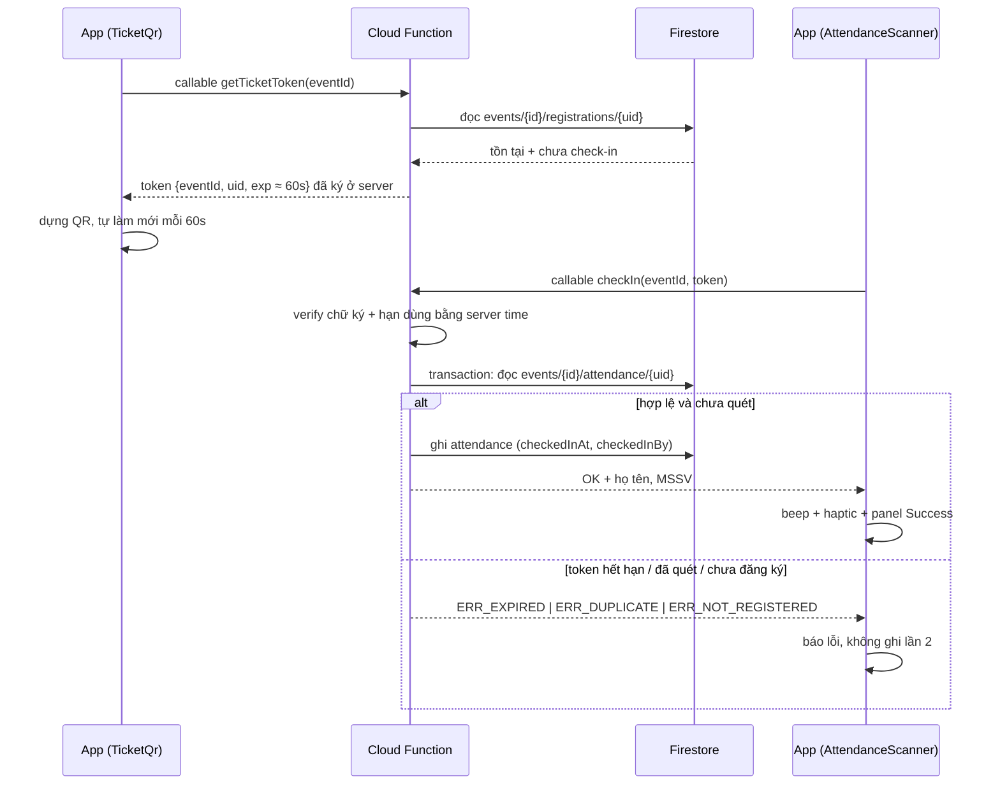
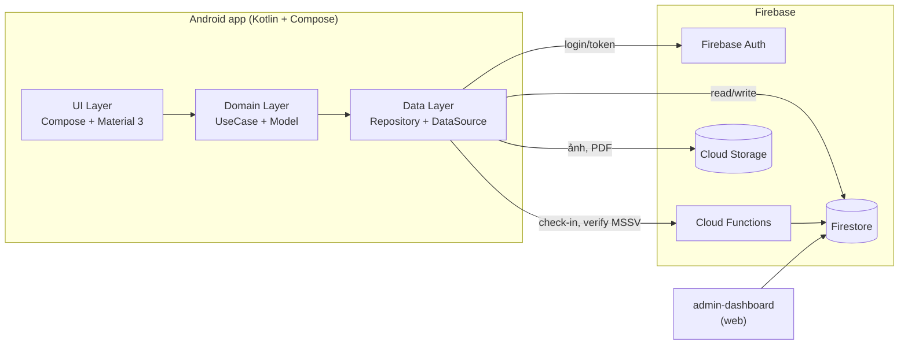
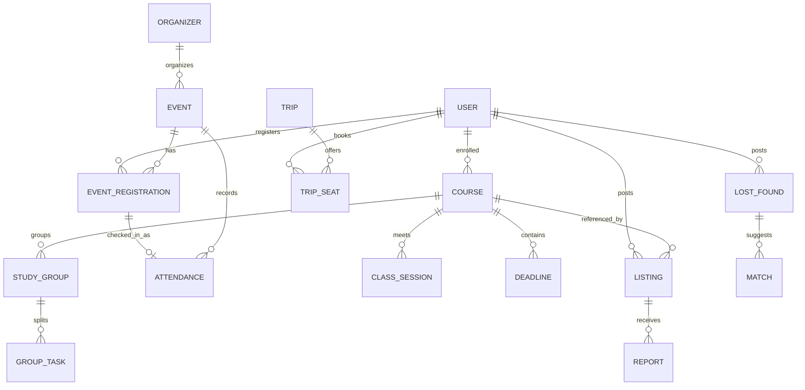

<div align="center">

# UTH Connect

**Ứng dụng nội bộ dành cho sinh viên UTH — hẹp, sâu, dùng được thật.**

`Android · Kotlin · Jetpack Compose · Material 3`

[](https://developer.android.com)
[](https://kotlinlang.org)
[](https://developer.android.com/jetpack/compose)
[](https://developer.android.com/about/versions/12)
[](#11-lộ-trình-roadmap)
[](#14-giấy-phép)

</div>

---

UTH Connect gom **6 tiện ích thật** của đời sinh viên UTH vào một app: **sự kiện/CLB + QR check-in**, **thời khóa biểu + deadline**, **chợ sách giáo trình**, **ghép trọ**, **đồ thất lạc**, **ghép xe đi chung**.
Không làm báo chí, không làm mạng xã hội tổng hợp — mỗi phân hệ giải quyết xong một bài toán cụ thể rồi mới mở rộng.

**Bộ tài liệu** (nguồn nào thắng khi hai file mâu thuẫn — để tránh lệch lại như bản UTH Social cũ):

| File | Chứa | Thắng về |
|---|---|---|
| `docs/Design.md` | phạm vi, giai đoạn, vai trò, luồng nghiệp vụ, dữ liệu, bảo mật, NFR, rủi ro | scope & nghiệp vụ |
| `docs/Design-system.md` | token màu/chữ/spacing/bo góc, component, dark mode, accessibility, motion | giao diện |
| `README.md` (bạn đang đọc) | spec chi tiết từng module, wireframe, API, roadmap, metrics, contributing | — |
| `docs/GIT_WORKFLOW.md` | nhánh `main`/`develop`/`feature/<module>-<tên>`, phân quyền, branch protection, mẫu commit/PR | quy trình Git |
| `docs/CODING_STANDARDS.md` | quy ước code: đặt tên, ranh giới tầng, Kotlin/Compose style, coroutines, test | cách viết code |
| `docs/REPO_TREE.md` | cây thư mục, ai sở hữu package nào, file chung được sửa ra sao, nghi thức gộp cây | cấu trúc & phân quyền file |

---

## Mục lục

1. [Bối cảnh và vấn đề](#1-bối-cảnh-và-vấn-đề)
2. [Định vị sản phẩm](#2-định-vị-sản-phẩm)
3. [Preview chi tiết các phân hệ](#3-preview-chi-tiết-các-phân-hệ)
4. [Preview giao diện](#4-preview-giao-diện)
5. [Kiến trúc](#5-kiến-trúc)
6. [Data model](#6-data-model)
7. [Cấu trúc thư mục](#7-cấu-trúc-thư-mục)
8. [Bắt đầu nhanh](#8-bắt-đầu-nhanh)
9. [Cấu hình môi trường](#9-cấu-hình-môi-trường)
10. [Phạm vi học kỳ doanh nghiệp](#10-phạm-vi-học-kỳ-doanh-nghiệp)
11. [Lộ trình (Roadmap)](#11-lộ-trình-roadmap)
12. [Đo lường hiệu quả](#12-đo-lường-hiệu-quả)
13. [Đóng góp](#13-đóng-góp)
14. [Giấy phép](#14-giấy-phép)

---

## 1. Bối cảnh và vấn đề

### 1.1. Từ UTH Social đến UTH Connect

Dự án tiền nhiệm [App_UTH_Social](https://github.com/ThinhNguyen2005/App_UTH_Social) đã xây được nền tảng khá tốt: app Android, `admin-dashboard`, Firebase, hơn 170 commit. Tuy nhiên **phạm vi quá rộng**:

| Phân hệ trong UTH Social | Giá trị với sinh viên UTH | Đánh giá |
|---|---|---|
| Tin tức đa chuyên mục (Thời sự, Thể thao, Giải trí, Công nghệ…) | Gần bằng 0 — đã có VNExpress, Tuổi Trẻ, Thanh Niên | **Cắt**: không tạo khác biệt, chi phí vận hành nội dung cao |
| Nhắn tin / like / comment | Trung bình — Facebook, Zalo đã làm tốt hơn | **Cắt ở MVP**: cạnh tranh trực tiếp với nền tảng có sẵn, bài toán PM rất khó |
| Mua bán & trao đổi sách | **Cao** — nhu cầu lặp lại mỗi học kỳ | **Giữ lại** ở backlog (3.6), dựng trên listing engine dùng chung với 3.2 |
| Thông báo sự kiện / Đoàn–Hội | **Cao** — gắn với điểm rèn luyện | **Nâng thành phân hệ trung tâm** (mục 3.1) |

> **Kết luận:** một sản phẩm hẹp mà sinh viên mở ra dùng hằng tuần sẽ ăn điểm hơn một app "cái gì cũng có chút".

### 1.2. Nguyên tắc chọn tính năng

Một tính năng chỉ được vào UTH Connect khi hội đủ **cả 4** điều kiện:

1. **Độc quyền theo trường** — không thể thay bằng Facebook/Zalo/TikTok.
2. **Có người dùng thật trong khuôn viên UTH** đo được trong 1 học kỳ (≥ 100 user hoạt động).
3. **Sinh viên chủ động tạo nội dung** — nhà trường không cần biên tập viên.
4. **Demo trực quan trong 3 phút** — có dòng "đăng → tìm → gặp/hoàn thành" khép kín.

---

## 2. Định vị sản phẩm

| Yếu tố | Nội dung |
|---|---|
| **Người dùng chính** | Sinh viên UTH (các cơ sở), ưu tiên năm 1–3 ở trọ/thành phố lạ |
| **Người dùng phụ** | CLB/Đoàn–Hội (tổ chức sự kiện), giảng viên cố vấn, cựu sinh viên |
| **Job to be done** | "Giúp tôi xử lý các việc lặt vặt của đời sinh viên trong một app duy nhất, tin cậy vì có xác thực sinh viên" |
| **Lợi thế** | Danh tính sinh viên được xác thực (MSSV/email trường) → an toàn hơn chợ mạng xã hội |
| **Không làm** | Tin tức tổng hợp, feed xã hội, video, thanh toán online trong MVP |

---

## 3. Preview chi tiết các phân hệ

Thứ tự ưu tiên lấy theo **giai đoạn trong `docs/Design.md` mục 3** (nguồn quyết định scope):

| Giai đoạn | Module | Nhãn |
|---|---|---|
| **MVP (Phase 1)** | 3.1 Sự kiện/CLB + QR check-in · Auth + xác thực MSSV · Admin Dashboard | `P0` |
| **Phase 2** | 3.3 Thời khóa biểu + Deadline tracker + nhóm học | `P1` |
| **Phase 3** | 3.4 Đồ thất lạc | `P1` |
| **Backlog** | 3.2 Ghép trọ · 3.6 Chợ sách · 3.5 Ghép xe | `P2` |

> Không mở module mới khi module đang làm chưa đạt Definition of Done (mục 10.2).

### 3.1. Sự kiện & CLB với QR check-in — `P0` · MVP

> *Quản lý sự kiện/CLB: tạo sự kiện, đăng ký, quét QR điểm danh, thống kê tham gia (gần với điểm rèn luyện).*

**Bài toán.** CLB gửi thông báo qua fanpage → sinh viên đọc xong quên → tới nơi không ai biết mình đã đăng ký → trưởng CLB tổng hợp danh sách bằng Excel.

**Luồng chính.**

```
[Trưởng CLB] Tạo sự kiện ──▶ [BTC] Duyệt ──▶ [SV] Xem & đăng ký ──▶ [SV] Nhận QR cá nhân
                                                                     │
                          [BTC] Quét QR tại cửa ──▶ Ghi nhận check-in ◀┘
                                     │
                          [SV] Nhận xác nhận + giờ vào ──▶ [BTC] Export CSV / bảng tổng kết
```

**Luồng check-in ở mức API** (mỗi vé chỉ được ghi nhận một lần, kể cả khi 2 máy BTC quét cùng lúc):



**Màn hình.**

| Màn hình | Nội dung |
|---|---|
| `EventList` | Card sự kiện: ảnh bìa, tiêu đề, cơ sở, thời gian, số chỗ còn, nhãn CLB, trạng thái `ĐANG MỞ / SẮP DIỄN RA / ĐÃ KẾT THÚC` |
| `EventDetail` | Mô tả, lịch trình, người tổ chức, bản đồ, nút **Đăng ký / Hủy đăng ký**, đếm ngược |
| `TicketQr` | QR **động** từ token ký ở server (TTL ~60 s, tự refresh), trạng thái check-in, mã dự phòng 6 số |
| `AttendanceScanner` | Camera + overlay, beep + haptic + kết quả "Đã điểm danh: Nguyễn Văn A — MSSV …", chống quét lại |
| `EventStats` | Tỷ lệ tham gia, danh sách chưa đến, tìm theo MSSV, xuất CSV |

**Chức năng MVP / chưa làm**

- [x] CRUD sự kiện, phân loại theo CLB và cơ sở
- [x] Đăng ký có giới hạn số chỗ + danh sách chờ (transaction phía server)
- [x] QR check-in **một chiều** (BTC quét mã vé), ghi timestamp, phát hiện quét trùng
- [x] **QR động**: token `eventId + uid + exp (~60 s)` do Cloud Function ký, app tự làm mới
- [x] Thống kê phần trăm tham gia + export CSV
- [ ] *Fallback nếu chưa chốt gói Blaze:* QR tĩnh `ticketId` + mã 6 số — vẫn chống trùng ở server, nhưng mất khả năng chống chụp màn hình (phải nói rõ khi demo)
- [ ] Check-in 2 chiều (user quét QR của BTC) — *V1*
- [ ] Chữ ký số cho ban tổ chức — *Later*

**API (Firestore / Cloud Function).**

| Method | Endpoint | Mô tả |
|---|---|---|
| `POST` | `/events` | Tạo sự kiện (role: `organizer`) |
| `GET` | `/events?campus=&club=&status=` | Danh sách có lọc |
| `POST` | `/events/{id}/registrations` | Đăng ký, cấp `registrationId` |
| `callable` | `getTicketToken(eventId)` | Trả token ký ngắn hạn (TTL ~60 s) để dựng QR |
| `GET` | `/events/{id}/registrations/{uid}` | Thông tin vé + trạng thái |
| `callable` | `checkIn(eventId, token)` | Chỉ Organizer; idempotent, toàn bộ kiểm tra ở server |
| `GET` | `/events/{id}/stats` | Số đăng ký / đã đến / vắng |

**Tiêu chí nghiệm thu.**

- Quét QR thành công dưới ánh sáng yếu trong ≤ 1.5 s, phản hồi lỗi rõ khi vé không hợp lệ.
- Hai thiết bị quét cùng một vé → chỉ **một** lần ghi nhận (chống race bằng transaction).
- Sự kiện 300 sinh viên: bảng tổng kết load < 2 s, export CSV đủ cột `Họ tên, MSSV, Lớp, Giờ vào`.

**Rủi ro & giảm thiểu.** QR chụp màn hình gửi cho bạn → **token động đổi sau ~60 s** (thuộc MVP, `docs/Design.md` mục 4.2); Cloud Functions cần gói Blaze → fallback QR tĩnh + mã 6 số; camera bị từ chối quyền → nhập mã 6 số.

---

### 3.2. Ghép trọ / tìm bạn ở ghép — `P2` · Backlog

**Bài toán.** Sinh viên năm nhất tìm phòng quanh trường qua nhóm Facebook đầy môi giới và tin ảo; cần lọc theo **giá, khoảng cách tới cơ sở, giới tính, giờ giấc**, và người đăng **được xác thực là sinh viên UTH**.

**Luồng.** `Đăng bài (ảnh + giá + vị trí + mô tả) → Duyệt tự động theo rule → Bộ lọc (giá / khoảng cách / giới tính) → Liên hệ trong app (không lộ SĐT) → Đánh dấu "Đã tìm được"`.

| Trường dữ liệu | Ghi chú |
|---|---|
| `price`, `deposit`, `utilities` | VND, có/không kể điện nước |
| `campusDistanceM` | Khoảng cách tới cơ sở, tính từ toạ độ chuẩn UTH |
| `roommates[]`, `genderPref`, `schedulePref` | Giờ giấc sinh hoạt, hút thuốc, nuôi thú cưng… |
| `verifiedBy` | `email_uth` \| `mssv` — gắn badge trên card |

**Chống lạm dụng.** Tối đa 2 tin đang mở / user; báo cáo tin ảo → ẩn sau 3 báo cáo; ảnh trùng hash với tin đã ẩn → chặn.

**Tiêu chí nghiệm thu.** Lọc 500 tin < 300 ms trên thiết bị; badge xác thực hiển thị ở mọi card; chủ tin có thể đánh dấu "hết phòng" để gỡ khỏi danh sách.

---

### 3.3. Thời khóa biểu + Deadline tracker — `P1` · Phase 2

**Bài toán.** Lịch học nhận từ cổng trường dưới dạng PDF/ảnh; deadline môn học rải rác trong email nhóm; không có nơi tổng hợp để biết **tuần này phải nộp gì**.

**Luồng.** `Nhập lịch (gõ tay nhanh / nhập từ ảnh thời khóa biểu bằng OCR) → app tự sinh ca học theo tuần → Nhập deadline từng môn → Notification theo mốc T-3 / T-1 / giờ G → Nhóm học chung để giao việc`.

**Điểm khác biệt.**
- **Widget màn hình chính** hiển thị 3 môn ngày mai + deadline gần nhất.
- **Trợ lý AI (V1)**: tóm tắt tài liệu PDF/PPTX theo môn; hỏi–đáp giới hạn trong ngữ cảnh môn học, có dẫn chứng trang.
- **Nhóm học chung**: tạo nhóm theo môn, chia việc, nhắc nhau nộp.

| Loại nhắc nhở | Cơ chế |
|---|---|
| Trước deadline | `WorkManager` + `AlarmManager` exact, mốc T-3 ngày, T-1 ngày, đúng giờ |
| Ca học sắp bắt đầu | 15 phút trước, tắt được theo từng môn |
| Deadline quá hạn | Đưa vào danh sách "Cần xử lý", hiện huy hiệu đỏ ở tab |

**Tiêu chí nghiệm thu.** Nhập xong một học kỳ (≈ 8 môn) dưới 3 phút; nhắc đúng giờ ± 1 phút ngay cả khi app bị giết; dữ liệu nằm local, chỉ đồng bộ khi user đăng nhập.

---

### 3.4. Đồ thất lạc (Lost & Found) — `P1` · Phase 3

> *Nhỏ nhưng demo rất trực quan: đăng ảnh kèm vị trí.*

**Luồng.** `Nhặt/Mất → Đăng (ảnh, mô tả, vị trí trên bản đồ khuôn viên, mốc thời gian) → Đối khớp theo từ khóa + danh mục + vị trí → Hai bên xác nhận → Giao dịch hoàn tất (gặp tại bảo vệ/Đoàn trường)`.

**Cấu trúc đăng tin.**

| Trường | Ví dụ |
|---|---|
| `type` | `LOST` \| `FOUND` |
| `category` | Giấy tờ, ví, sạc/laptop, chìa khoá, bình nước, khác |
| `spot` | Giảng đường B1, thư viện, sân bóng, nhà xe cơ sở … |
| `occurredAt` / `postedAt` | Mốc rơi mất và mốc đăng |
| `handoffPoint` | Nơi nhận lại (mặc định: Phòng Bảo vệ) |

**Chi tiết làm nên khác biệt.** Che thông tin nhạy cảm trên ảnh (OCR + làm mờ); yêu cầu người nhận mô tả **1 chi tiết không có trong ảnh** trước khi hoàn tất; tự động đẩy tin quá 45 ngày sang "Lưu trữ" và chuyển về Đoàn trường.

**Tiêu chí nghiệm thu.** Đăng 1 tin kèm vị trí ≤ 45 s; danh sách khớp tiềm năng gợi ý ngay khi gõ; mọi tin có trạng thái `ĐANG TÌM / ĐÃ LIÊN HỆ / ĐÃ TRẢ LẠI`.

---

### 3.5. Ghép xe đi chung — `P2` · Backlog

**Bài toán.** Di chuyển giữa các cơ sở hoặc về quê dịp lễ/tết; ghế trống của người này là nhu cầu của người khác.

**Luồng.** `Tạo chuyến (điểm đi–đến, giờ, số ghế, chi phí chia) → Sinh viên cùng tuyến thấy trong danh sách → Xác nhận ngồi → Cả hai bên đánh giá lẫn nhau sau chuyến`.

| Biện pháp an toàn | Mô tả |
|---|---|
| Bắt buộc xác thực MSSV | Chỉ user đã verify được tạo/xác nhận chuyến |
| Chia sẻ hành trình | Gửi link theo dõi cho người thân lúc đang di chuyển |
| Đánh giá 2 chiều | Điểm thấp bị hạn chế; báo cáo → tạm khoá tính năng |
| Không thu tiền trong app | Chỉ hiển thị chi phí thoả thuận, tránh rủi ro pháp lý |

**Tiêu chí nghiệm thu.** Danh sách chuyến lọc theo cơ sở + ngày trong < 1 s; có màn hình "Chuyến của tôi" với trạng thái rõ; cho phép tắt thông báo theo tuyến.

---

### 3.6. Chợ sách giáo trình trong khuôn viên — `P2` · Backlog

**Bài toán.** Đầu học kỳ, nhiều bạn mua sách chuyên ngành giá bìa trong khi sách của khoá trước nằm im trong ký túc xá. Đây chính là phần đáng giá nhất của UTH Social — UTH Connect giữ lại, nhưng bỏ hẳn lớp "mạng xã hội" bao quanh nó.

**Luồng.** `Đăng sách (quét barcode hoặc chụp bìa → tự điền tên/tác giả/NXB) → Người tìm lọc theo mã môn, học kỳ, tình trạng → Nhắn tin trong app → Giao tại trường → Xác nhận đã bán`.

| Trường dữ liệu | Ghi chú |
|---|---|
| `isbn`, `title`, `author`, `edition` | Tự động nạp từ barcode (ML Kit) khi quét |
| `courseRefs[]` | Gắn với môn trong thời khóa biểu → gợi ý "sách bạn cần học kỳ này" |
| `condition`, `price`, `bundle` | Tình trạng, giá, bán kèm tài liệu photo |
| `tradeMode` | `MUA` \| `TRAO_DOI` \| `TANG` \| `CHO_MUON` |

**Khác biệt so với nhóm Facebook.** Tra cứu theo **mã môn học** chứ không theo từ khóa tự do; người bán đã xác thực MSSV; cuối học kỳ gợi ý "bán lại cho khoá sau" đúng thời điểm.

**Tiêu chí nghiệm thu.** Quét barcode → hiện thông tin sách < 2 s; mục "Sách cần cho học kỳ này" tự dựng từ thời khóa biểu (3.3); đổi trạng thái `DANG_BAN → DA_BAN` trong một chạm.

---

## 4. Preview giao diện

> Khung phác hoạ dưới đây là **wireframe** thống nhất để cả đội cùng thiết kế trên Figma; ảnh chụp thật sẽ được gắn vào mục này khi có build.

**Thiết kế:** [Link Figma — UTH Connect]() *(cập nhật link khi dựng file thiết kế)*

### 4.1. Tab Sự kiện + vé QR

```
UTH Connect                            [Tìm]  [Thông báo]
──────────────────────────────────────────────────────────
Cơ sở:  (•) Quang Trung   ( ) Nguyễn Tất Thành   ( ) Thủ Đức
CLB: Tất cả ▾                                  Sắp diễn ra ▾

  ▓▓▓▓▓▓▓▓▓▓▓▓▓▓  ảnh bìa 16:9  ▓▓▓▓▓▓▓▓▓▓▓▓▓▓
  Hội thao Sinh viên UTH 2026
  12/11 · 07:00 · CS Quang Trung · CLB Thể Thao
  42/200 đã đăng ký          [ Đăng ký ]   [ Lưu lại ]
  ──────────────────────────────────────────
  Giao lưu CLB Ánh Sáng
  15/11 · 18:30 · CS Nguyễn Tất Thành
  Sắp diễn ra · còn 8 chỗ        [ Đăng ký ]

  [ Sự kiện ]   [ Vé của tôi ]   [ CLB ]   [ Cá nhân ]
```

### 4.2. Màn hình quét QR check-in

```
← Quét điểm danh                  Sự kiện: Hội thao 2026
──────────────────────────────────────────────────────────
        ▛▀▀▀▀▀▀▀▀▀▀▀▀▀▀▀▀▀▀▀▀▀▜
        ▌                      ▌
        ▌    khung lấy QR      ▌   <─ vùng CameraX
        ▌                      ▌
        ▙▄▄▄▄▄▄▄▄▄▄▄▄▄▄▄▄▄▄▄▄▄▄▟

  Đã quét 128  ·  Trùng 2  ·  Còn vắng 44
  ──────────────────────────────────────────
  [OK] Nguyễn Văn A · 2023040123 · 07:04:12
  [ERR] Vé không tồn tại (mã 812390)
  [OK] Trần Thị B · 2023040177 · 07:04:31
  ──────────────────────────────────────────
  [ Nhập mã 6 số thủ công ]   [ Danh sách chưa đến ]
```

### 4.3. Thời khóa biểu + Deadline tracker

```
Tuần này                     ‹ Tuần 7 ›        [+ Deadline]
──────────────────────────────────────────────────────────
CẦN XỬ LÝ
  ! Tiểu luận nhóm 30%  ·  TLHT        còn 2 ngày
      [ Đánh dấu đã nộp ]  [ Xem nhóm ]
  ! Bài tập lớn         ·  CẤU TRÚC DL còn 5 ngày

LỊCH NGÀY MAI
  07:00–09:00  Anh văn 3       B102
  09:15–11:00  PT ƯDM           A203
  13:00–15:00  HT Web           Lab 3
  17:00–19:00  Hội thao 2026    CS Quang Trung   (từ 3.1)

NHÓM HỌC
  TLHT-N04 · 4 thành viên · 2 việc chưa xong        [ Vào nhóm ]
```

### 4.4. Màn hình ghép trọ có bộ lọc

```
Ghép trọ                        [Lọc ▾]  [Bản đồ]  [+ Đăng tin]
──────────────────────────────────────────────────────────
Giá ≤ 2.500.000đ · ≤ 3 km · Nữ · Chỉ hiện tin đã xác thực

  [ảnh]  Phòng 2 người · Quận 12
         2.300.000đ/tháng (điện nước tách)
         1.8 km → CS Nguyễn Tất Thành · ✔ SV đã verify
         Ưu tiên: ở dài hạn, không hút thuốc
         [ Xem chi tiết ]   [ Nhắn tin ]
  ────────────────────────────────────────
  [ảnh]  Tìm bạn ở ghép · Thủ Đức
         1.500.000đ/tháng · 3.6 km · ✔ SV đã verify
         [ Xem chi tiết ]   [ Nhắn tin ]
```

### 4.5. Chợ sách theo mã môn học

```
Sách giáo trình                    [Tìm sách]  [+ Đăng bán]
──────────────────────────────────────────────────────────
SÁCH CẦN CHO HỌC KỲ NÀY (từ thời khóa biểu của bạn)
  Anh văn 3 · Nguyễn Thị X · NXB Tổng Hợp     90.000đ  [Xem]
  Cấu trúc dữ liệu · Clayton Anderson         145.000đ  [Xem]
──────────────────────────────────────────────────────────
Lọc:  Mã môn ▾   Tình trạng ▾   Chỉ trao đổi ▾  CS ▾

  Giáo trình HT Web (2024) · ít ghi chú  120.000đ · TRAO_DOI
  Bán kèm: slide + đề cương 2025          [ Nhắn tin ]
```

### 4.6. Gallery (cập nhật khi có build)

| Sự kiện | Quét QR | Thời khóa biểu | Ghép trọ | Chợ sách |
|---|---|---|---|---|
| _(ảnh)_ | _(ảnh)_ | _(ảnh)_ | _(ảnh)_ | _(ảnh)_ |

---

## 5. Kiến trúc

> Quyết định kiến trúc và phạm vi nghiệp vụ nằm trong `docs/Design.md` (mục 3, 4, 5). Hệ thống token giao diện/component nằm trong `docs/Design-system.md`. Mục này chỉ tóm tắt + đối chiếu với mã nguồn thật.

### 5.1. Tổng quan



### 5.2. Layer và quy ước

| Layer | Vị trí (hiện tại → đích) | Vai trò | Ràng buộc |
|---|---|---|---|
| `ui` | `presentation/<module>/Screen.kt` → `feature/<ten>/ui` | Composable, `@Preview`, stateless | Không gọi repository, không `hiltViewModel()`, không logic nghiệp vụ |
| `route` | `presentation/<module>/Route.kt` | nối ViewModel với Screen, collect state bằng `collectAsStateWithLifecycle()` | Chỗ **duy nhất** trong module được chạm `hiltViewModel()` |
| `viewmodel` | `presentation/<module>/ViewModel.kt` | `@HiltViewModel` + `@Inject constructor`, giữ `StateFlow<UiState>`, điều phối use case | Không tham chiếu `Context`/`Modifier`/`@StringRes` |
| `domain` | `domain/model` · `domain/repository` · `domain/usecase` | UseCase + entity thuần Kotlin, `suspend` trả `Result<T>` | Không import `android.*`/`androidx.*` (chỉ thêm `javax.inject`) |
| `data` | `data/repository` · `data/di` | Repository, Firestore/Firebase mapper, cache Room, `@Binds` module của **từng module** | Ẩn toàn bộ chi tiết backend khỏi domain |
| `core` | `core/designsystem` | Design system | Feature không import lẫn nhau |

**Pattern:** Clean Architecture + **MVVM/UDF** (Screen nhận `UiState`/phát `Action`, ViewModel giữ `StateFlow`, UseCase mới được gọi Repository), single-activity, `StateFlow` một nguồn sự thật, **Hilt** cho DI (đã vào, xem `docs/REPO_TREE.md` mục 4), `Room` cache cục bộ cho thời khóa biểu (offline-first). Sườn đã dựng xong và có **một slice mẫu đi đủ đường** — tab Tiện ích (`presentation/utilities/`, 5 file + test). Module nào cũng bắt đầu bằng cách copy đúng cấu trúc đó; chi tiết mục 5.1.1 của `docs/Design.md` và `docs/CODING_STANDARDS.md` mục 3.2.

### 5.3. Tech stack (theo mã nguồn hiện tại)

| Hạng mục | Phiên bản / lựa chọn | Nguồn |
|---|---|---|
| Android Gradle Plugin | `9.3.3` | `gradle/libs.versions.toml` |
| Kotlin | `2.2.10` (+ `org.jetbrains.kotlin.plugin.compose`) | `gradle/libs.versions.toml` |
| Compose BOM | `2026.02.01`, Material 3 | `app/build.gradle.kts` |
| `compileSdk` | `37.1` (minor API level 1) — cần vì core-ktx 1.19.1/lifecycle 2.11.0/navigation 2.10.2 đòi API 37 | `app/build.gradle.kts` |
| `targetSdk` | `36` | `app/build.gradle.kts` |
| `minSdk` | `31` (Android 12) | `app/build.gradle.kts` |
| Namespace / applicationId | `com.giathinh.uthconnect` | `app/build.gradle.kts` |
| UI | Jetpack Compose + Material 3, single activity, edge-to-edge | `MainActivity.kt` |
| Lifecycle | `runtime-ktx` + `viewmodel-compose` + `runtime-compose` `2.11.0` (`collectAsStateWithLifecycle()`; `viewModel()` không còn dùng vì Route đã chuyển sang `hiltViewModel()`), `activity-compose 1.13.0` | catalog — hai artifact compose khai tường minh để ghim bản, không để BOM/Navigate kéo xuống bản cũ |
| **DI** | **Hilt `2.60.1`** chạy trên **KSP `2.3.12`**, plugin `com.google.dagger.hilt.android`; `androidx.hilt:hilt-lifecycle-viewmodel-compose 1.4.0` cho `hiltViewModel()` | catalog · `app/build.gradle.kts` · `UTHConnectApplication.kt` |
| **Serialization** | plugin `org.jetbrains.kotlin.plugin.serialization` (`2.2.10`, khớp Kotlin) + `kotlinx-serialization-json 1.9.0` — bật cho route `@Serializable` type-safe | catalog · `app/build.gradle.kts` |
| Java compatibility | đang `VERSION_11` và build xanh; tài liệu Hilt khuyến nghị 17 — chỉ đổi khi gặp lỗi thật từ code Hilt sinh ra | `app/build.gradle.kts` |
| Async | Kotlin Coroutines `1.9.0` (resolve qua BOM, chưa khai báo tường minh trong catalog) | `gradlew :app:dependencies` |
| Test | JUnit 4.13.2, `kotlinx-coroutines-test 1.9.0` (`MainDispatcherRule` cho ViewModel), Compose UI Test, Espresso 3.7.0 | catalog; 4 test ViewModel đang chạy xanh |
| Test *(bổ sung dự kiến)* | MockK, Turbine, Firebase Emulator Suite | `docs/Design.md` mục 5.2 |
| Backend *(dự kiến)* | Firebase Auth, Firestore, Storage, Cloud Functions, FCM | kế thừa từ UTH Social |
| QR *(dự kiến)* | CameraX + ML Kit Barcode; tạo mã bằng ZXing | chưa thêm vào build |
| Room / DataStore *(dự kiến)* | Room, DataStore | chưa thêm vào build (DI **đã** thêm — xem dòng DI ở trên) |
| Navigation | **Navigation Compose `2.10.2`** — đã thêm, đang chạy 4 tab **type-safe** (`@Serializable object` · `composable<T>` · `hasRoute`) | `presentation/navigation/UthApp.kt` · `UthDestination.kt` |
| Icon | `material-icons-core 1.7.8` (đã đóng băng, chỉ dùng cho khung nav/badge) | icon thiết kế riêng sẽ là vector drawable |
| Crash / perf *(dự kiến)* | Firebase Crashlytics, Macrobenchmark | phục vụ metrics mục 12 |
| CI *(dự kiến)* | GitHub Actions (build, lint, unit test) | `docs/Design.md` mục 5.2 |
| Design tokens | Material 3 `ColorScheme` + `Typography` + `Shapes`, token theo `docs/Design-system.md` | `core/designsystem/theme/Color.kt` · `Type.kt` · `Dimens.kt` · `Theme.kt` |

> **Trạng thái mã nguồn (đã kiểm chứng):** `:app:assembleDebug` và `:app:testDebugUnitTest` **BUILD SUCCESSFUL** (5 test, 0 lỗi, KSP chạy sạch không warning). Đã có: design system (màu Navy/Gold + 11 role chữ + `UthDimens`), component dùng chung (`UthCard`, `UthPrimaryButton`, `UthStatusBadge`, `UthEmptyState`), 4 tab `Trang chủ · Thời khóa biểu · Tiện ích · Cá nhân` với `NavHost` + `NavigationBar`, cấu trúc `core/ · data/ · domain/ · presentation/`, **sườn MVVM** với slice mẫu ở tab Tiện ích (`Screen/Route/ViewModel/UiState/Action` + `GetUtilityModulesUseCase` + `UtilitiesDataModule`), và **DI bằng Hilt** (`@HiltAndroidApp` · `@AndroidEntryPoint` · `@Binds` · `@HiltViewModel` · `hiltViewModel()`) — `AppContainer`/`CompositionLocal` DI và các `ViewModelFactory` đã bị xoá, không còn đường code cũ; 4 tab NavHost đã chuyển **route type-safe** (`@Serializable object` + plugin serialization, không còn chuỗi route trần). Ba tab còn lại vẫn là Screen placeholder — chưa phải MVVM cho tới khi branch của module đó thêm ViewModel. Các mục còn lại của phần 5–7 vẫn là **kiến trúc đích**; cột "dự kiến" ở bảng trên là dependency cần thêm khi bắt đầu từng feature.
>
> **`dynamicColor` đã tắt:** `Theme.kt` hiện có `dynamicColor: Boolean = false`. Trước đây để `true` nên Material You (mọi máy Android 12+, vì `minSdk = 31`) sẽ ghi đè màu thương hiệu; từ v0.3 màu nhận diện là Navy `#003366` + Gold `#F5A623` theo `docs/Design-system.md` mục 1.5.

---

## 6. Data model



> **QR không phải một entity.** Token điểm danh chỉ sống ~60 giây và do Cloud Function ký, không lưu vào Firestore; trạng thái "đã điểm danh" lấy từ `attendance` (theo `docs/Design.md` mục 4.2).
>
> 3.2 ghép trọ và 3.6 chợ sách dùng chung một mô hình `LISTING` (chỉ khác `kind` và trường mở rộng) → chỉ cần **một listing engine** cho cả hai. 3.5 ghép xe giữ collection riêng `trips` vì có ngữ nghĩa số ghế/lịch trình.

**Collection chính (Firestore).**

| Collection | Khóa | Trường then chốt | Giai đoạn |
|---|---|---|---|
| `users/{uid}` | uid (MSSV là trường) | `displayName`, `studentId`, `faculty`, `avatarUrl`, `createdAt` — **role nằm trong custom claims, không lưu ở doc** | MVP |
| `organizers/{orgId}` | slug | `name`, `description`, `logoUrl`, `ownerUid`, `status` (`pending/approved/rejected`) | MVP |
| `events/{eventId}` | UUID | `orgId`, `title`, `description`, `location`, `campus`, `startAt`, `endAt`, `capacity`, `registeredCount`, `status` (`draft/published/cancelled`), `coverUrl` | MVP |
| `events/{eventId}/registrations/{uid}` | uid | `registeredAt`, `status` (`registered/cancelled`) | MVP |
| `events/{eventId}/attendance/{uid}` | uid | `checkedInAt`, `checkedInBy` | MVP |
| `reports/{reportId}` | UUID | `targetType`, `targetId`, `reason`, `reporterUid`, `status` | MVP |
| `courses/{courseId}`, `deadlines/{id}` | mã môn / UUID | `sessions[]`, `dueAt`, `weight`, `status`, `remindedAt[]` | Phase 2 |
| `lostFound/{id}` | UUID | `kind` (`lost/found`), `category`, `spotId`, `imageUrl`, `status`, `ownerConfirmed` | Phase 3 |
| `listings/{listingId}` | UUID | `kind` (`room`/`book`), `userId`, `price`, `geo`, `distanceM`, `isbn`, `courseRefs[]`, `status`, `reportCount` | Backlog |
| `trips/{tripId}` | UUID | `driverId`, `from`, `to`, `departAt`, `seats`, `priceShare`, `status` | Backlog |

Subcollection theo `events/{eventId}` giúp một sự kiện không phải scan cả collection; nếu sau này cần query "mọi sự kiện của một sinh viên" mới tách ra collection phẳng kèm chỉ mục (`docs/Design.md` mục 6).

**Quy tắc bảo mật (Storage + Firestore Rules).**
- Vai trò lấy từ **custom claims** (`role`, `orgIds`), do Cloud Function/Admin SDK ghi sau khi Admin duyệt — rules **không** đọc role từ tài liệu `users/{uid}`.
- User có `uthVerified == true` (claim) mới được ghi `listings`, `trips`, `lostFound`.
- `registrations` do chính sinh viên ghi (đăng ký/hủy); `attendance` **chỉ** Cloud Function `checkIn` được ghi.
- Organizer chỉ sửa `events` thuộc `orgId` đã `approved` của mình; `status(draft→published)` cần Admin.
- Ảnh upload vào `users/{uid}/…`, giới hạn 8 MB, MIME `image/*`; PDF tài liệu vào `courses/{courseId}/materials`.
- Mọi query phải có `limit` (mặc định 25) và chỉ mục cho `campus + status + startAt`; index khai trong `firestore.indexes.json` và commit vào repo.
- Rules phải có **test bằng Firebase Emulator** cho từng collection (`docs/Design.md` mục 7).

---

## 7. Cấu trúc thư mục

### 7.1. Hiện tại (đã dựng, build xanh)

```
UTH Connect/
├── app/src/main/java/com/giathinh/uthconnect/
│   ├── MainActivity.kt              # single activity, edge-to-edge, @AndroidEntryPoint
│   ├── UTHConnectApplication.kt     # @HiltAndroidApp — gốc SingletonComponent
│   ├── core/
│   │   ├── designsystem/theme/      # Color.kt · Type.kt · Dimens.kt · Theme.kt
│   │   └── designsystem/component/  # UthComponents.kt · UthStatusBadge.kt
│   ├── data/
│   │   ├── repository/              # StaticUtilityModuleRepository (@Inject, @Singleton)
│   │   └── di/                      # UtilitiesDataModule.kt — @Binds của riêng module Tiện ích
│   ├── domain/
│   │   ├── model/                   # UtilityModule · DeliveryPhase · UtilityModuleId
│   │   ├── repository/              # interface, suspend + Result<T>
│   │   └── usecase/                 # GetUtilityModulesUseCase (@Inject constructor)
│   └── presentation/
│       ├── navigation/              # UthDestination.kt · UthApp.kt (Scaffold + NavHost + 4 tab)
│       ├── utilities/               # slice MVVM mẫu: Screen · Route · ViewModel · UiState · Action
│       └── home/ · schedule/ · profile/   # placeholder, chưa có ViewModel
├── app/src/test/java/com/giathinh/uthconnect/
│   ├── testing/MainDispatcherRule.kt        # đổi Dispatchers.Main cho test ViewModel
│   └── presentation/utilities/UtilitiesViewModelTest.kt   # 4 test
├── app/src/main/res/
│   ├── values/strings.xml           # chuỗi tiếng Việt (mặc định)
│   └── values-en/strings.xml        # bản dịch tiếng Anh
├── app/src/{test,androidTest}/      # JUnit + Compose UI Test
├── docs/GIT_WORKFLOW.md             # quy trình nhánh + phân quyền
├── docs/REPO_TREE.md                     # cây thư mục + ai sở hữu package nào (bắt buộc cập nhật khi đổi cấu trúc)
├── docs/CODING_STANDARDS.md              # quy ước viết code
├── gradle/libs.versions.toml        # version catalog
├── build.gradle.kts · settings.gradle.kts · gradle.properties
├── docs/Design.md · docs/Design-system.md · README.md
└── local.properties                 # không commit (đã .gitignore)
```

Chiều phụ thuộc đang áp dụng: `presentation → domain ← data`, và trong `presentation`: `Route → ViewModel → UseCase`. `domain` không import `androidx`. `core/designsystem` dùng được bởi mọi tầng.

### 7.2. Đích (multi-module)

Khi số module tăng lên, tách các package `presentation/<module>/` thành Gradle module thật như sơ đồ dưới. Bước này **chưa** làm — nhóm đang ở single-module với cấu trúc package đã chuẩn hoá ở 7.1.

```
app/                    # shell: navigation, DI graph, theme
core/
 ├─ designsystem/       # tokens, components: UthCard, UthChip, EmptyState
 ├─ model/              # entity thuần Kotlin
 ├─ data/               # repository, Firestore/Room sources
 └─ common/             # Result, date/money fmt, dispatchers
feature/
 ├─ events/             # 3.1  sự kiện + QR check-in  (MVP)
 ├─ housing/            # 3.2  ghép trọ              (Backlog)
 ├─ schedule/           # 3.3  thời khóa biểu + deadline (Phase 2)
 ├─ lostfound/          # 3.4  đồ thất lạc            (Phase 3)
 ├─ rideshare/          # 3.5  ghép xe               (Backlog)
 ├─ books/              # 3.6  chợ sách (dùng chung listing engine với housing) (Backlog)
 └─ auth/               # đăng nhập, verify MSSV/email trường + custom claims
functions/              # Cloud Functions: check-in, verify, matching
admin-dashboard/        # web admin (kế thừa từ UTH Social)
docs/                   # ADR, thiết kế UI, test plan
```

---

## 8. Bắt đầu nhanh

### 8.1. Yêu cầu

- Android Studio (Narwhal trở lên) với **SDK platform Android 37.1** (`compileSdk = 37.1`)
- JDK 17+
- Thiết bị/emulator **Android 12 (API 31)** trở lên
- Một project Firebase (hoặc dùng mode demo — xem mục 9)

### 8.2. Build và chạy

> **Trạng thái repo:** repo đang ở tên `UTH Connect` (applicationId `com.giathinh.uthconnect`). Đường dẫn `git clone` và các file `scripts/seed.mjs`, `.github/PULL_REQUEST_TEMPLATE.md`, `LICENSE`, `docs/adr/` là **chỗ để trống** sẽ được thêm ở milestone M0 — cập nhật lại đúng URL và tên module sau khi chuyển repo.

**Windows PowerShell** (`&&` không được hỗ trợ, dùng `;`):

```powershell
git clone https://github.com/ThinhNguyen2005/uth-connect.git
cd uth-connect
.\gradlew.bat :app:assembleDebug        # build APK debug
.\gradlew.bat :app:installDebug         # cài lên thiết bị đang kết nối
.\gradlew.bat testDebugUnitTest         # unit test
.\gradlew.bat connectedDebugAndroidTest # Compose UI / Espresso test
.\gradlew.bat lintDebug                 # static analysis
```

**macOS / Linux:**

```bash
git clone https://github.com/ThinhNguyen2005/uth-connect.git
cd uth-connect
./gradlew :app:assembleDebug
./gradlew :app:installDebug
./gradlew testDebugUnitTest lintDebug
```

### 8.3. Chạy local với Firebase

```powershell
npm install -g firebase-tools
firebase login
firebase init emulator   # chọn Firestore, Storage, Functions
firebase emulators:start # http://localhost:9099 (UI), 8080 (Firestore)
```

Trong app, bật **Emulator mode** ở `Settings → Developer` (điểm nối `10.0.2.2` trên emulator).

---

## 9. Cấu hình môi trường

| File / biến | Vai trò | Commit? |
|---|---|---|
| `local.properties` | đường dẫn SDK, `UTH_ENV=dev` | **Không** |
| `app/google-services.json` | khoá Firebase debug | Không — đưa vào CI secret |
| `.env` (Functions) | `VERIFY_SECRET`, `MAILGUN_KEY` | Không |
| `gradle.properties` | JVM args, `android.useAndroidX=true` | Có |

**Seeding dữ liệu demo** (phục vụ chấm bài):

```powershell
node scripts/seed.mjs --events 12 --rooms 30 --lostfound 25 --semester 2026-2
```

Script này dựng: 3 organizer đã duyệt + 4 CLB, 12 sự kiện (2 đã kết thúc, 1 full chỗ, có sẵn `registrations` và `attendance` mẫu), 1 học kỳ thời khóa biểu + 5 deadline cho tài khoản `demo@uth.edu.vn`, và dữ liệu mẫu cho các module backlog (30 tin ghép trọ, 25 tin lost & found) để demo khi cần.

---

## 10. Phạm vi học kỳ doanh nghiệp

### 10.1. Cắt / giữ (theo `docs/Design.md` mục 3)

| Nhóm | Nội dung | Quyết định |
|---|---|---|
| **Bắt buộc (MVP / Phase 1)** | Auth + Profile xác thực MSSV/email trường · 3.1 Sự kiện + QR check-in **động** (trọn luồng, có export CSV) · Admin Dashboard duyệt Organizer | Làm xong, dùng được bởi ≥ 1 CLB thật |
| **Phase 2** | 3.3 Thời khóa biểu + nhắc deadline + nhóm học | Bắt đầu sau khi 3.1 đạt DoD |
| **Phase 3** | 3.4 Lost & Found | Cắt nếu trễ milestone M4 |
| **Backlog** | 3.2 Ghép trọ · 3.6 Chợ sách · 3.5 Ghép xe · AI tóm tắt tài liệu · iOS · thanh toán | Chỉ mở khi có người kiểm duyệt nội dung; cần kiểm duyệt + xác thực trước khi public |
| **Không làm** | Tin tức đa chuyên mục, feed xã hội, story, video, chat group, tích hợp API hệ thống đào tạo | Loại vĩnh viễn khỏi scope |

### 10.2. Definition of Done của một feature

- [ ] Dùng token + component đã có trong `core/designsystem/` (`UthCard`, `UthPrimaryButton`, `UthStatusBadge`, `UthEmptyState`) — không tự khai màu/bo góc mới trong màn hình
- [ ] UI có `@Preview` cho trạng thái loading / empty / error, cả light + dark (dùng `UthPreview`)
- [ ] Đạt checklist design token & accessibility trong `docs/Design-system.md` mục 8 (không hardcode `.dp`/hex/`.sp`, tương phản đạt, trạng thái có icon + chữ)
- [ ] UseCase + Repository có unit test; luồng chính có Compose UI test
- [ ] Firestore/Storage Rules đã cập nhật **và có test emulator**
- [ ] Hỗ trợ offline hoặc thông báo mất kết nối rõ ràng
- [ ] Chuỗi tiếng Việt + tiếng Anh đầy đủ trong `res/values{,-en}/strings.xml`, không hardcode trong Composable
- [ ] Layout không vỡ ở font scale 200 % (preview `fontScale = 1.3f` trở lên)
- [ ] Có screenshot/GIF demo trong PR và cập nhật `docs/`
- [ ] Nhánh đặt theo `feature/<module>-<tên>`, PR nhắm vào `develop` (`docs/GIT_WORKFLOW.md`)
- [ ] Reviewer thứ hai approve; `.\gradlew.bat assembleDebug` xanh trên máy reviewer

---

## 11. Lộ trình (Roadmap)

Lộ trình này ánh xạ các giai đoạn trong `docs/Design.md` mục 3 sang 12 tuần của học kỳ doanh nghiệp.

| Mốc | Tuần | Kết quả cần đạt |
|---|---|---|
| **M0** | 1 | ✅ **Đã xong:** cấu trúc package Clean Architecture (`core/ · data/ · domain/ · presentation/`), design token Navy/Gold theo `docs/Design-system.md` (tắt `dynamicColor`), component dùng chung, khung navigation 4 tab, **sườn MVVM + slice mẫu Tiện ích** (`MainDispatcherRule` + 4 test ViewModel), **DI bằng Hilt + KSP** (đã xoá `AppContainer` và toàn bộ `ViewModelFactory`), `docs/CODING_STANDARDS.md`, `docs/REPO_TREE.md` (cây thư mục + phân quyền sở hữu), nhánh `develop` + `docs/GIT_WORKFLOW.md`. ⏳ **Còn lại:** CI (build + test) + ktlint/spotless, `hilt-android-testing` cho Compose UI test, login + verify email/MSSV + custom claims. Tách multi-module **chưa** làm (mục 7.2) — đang ở single-module. |
| **M1** | 2–4 | 3.1 tạo/đăng ký sự kiện, `getTicketToken` + `TicketQr` QR động, callable `checkIn` chống trùng |
| **M2** | 5–6 | `AttendanceScanner` hoàn thiện (haptic/queue khi mất mạng), `EventStats` + export CSV, Admin Dashboard duyệt Organizer |
| **M3** | 7–8 | Pilot 1 CLB + 60 sinh viên chạy **một sự kiện thật**; sửa lỗi bảo mật/hiệu năng ghi nhận từ pilot |
| **M4** | 9–10 | Phase 2: 3.3 lịch học offline-first + nhắc deadline + nhóm học |
| **M5** | 11–12 | Phase 3: 3.4 Lost & Found (hoặc gia cố MVP nếu pilot còn lỗi), báo cáo + video demo 3 phút |

**Bẫy scope cần tránh:** module chưa đạt DoD ở M3 thì **không** mở Phase 2 đúng hạn → cắt tính năng trong module, không cắt chất lượng, không mở thêm module.

**Backlog V1:** check-in 2 chiều (user quét QR của BTC) · import thời khóa biểu từ ảnh/PDF bằng OCR (**không** tích hợp API cổng trường — non-goal) · widget màn hình chính · thông báo đẩy theo nhóm học · thống kê điểm rèn luyện xuất được cho Đoàn trường.

---

## 12. Đo lường hiệu quả

| Metric | Mục tiêu cuối học kỳ | Cách đo |
|---|---|---|
| Sinh viên đã verify (email trường hoặc MSSV do Admin duyệt) | ≥ 300 | claim `uthVerified == true` |
| Sự kiện do Organizer tạo / học kỳ | ≥ 20 | `events` theo `startAt`, `status = published` |
| Tỷ lệ check-in thành công trên tổng đăng ký | ≥ 70 % | `attendance/{uid}` / `registrations/{uid}` |
| Vé quét lại/sai bị chặn đúng lúc | 100 % | log `ERR_DUPLICATE` / `ERR_EXPIRED` / `ERR_NOT_REGISTERED` |
| Thời gian quét một QR (p95) | ≤ 1.5 s | đo trên device tầm trung |
| Crash-free sessions | ≥ 99.5 % | Firebase Crashlytics |
| App cold start (p90) | ≤ 2 s | Macrobenchmark |
| Màn hình đạt checklist a11y/token | 100 % UI MVP | `docs/Design-system.md` mục 8 |

**Metric cho module có nội dung do người dùng đăng** (3.2, 3.4, 3.6 — chỉ đo khi đã mở): tin còn mở ≥ 90, tỷ lệ tin đã giải quyết ≥ 40 %, số tin bị báo cáo chưa xử lý ≤ 2 %.

**Dashboard giám sát:** `admin-dashboard` hiển thị user mới theo tuần, sự kiện sắp tới, tỷ lệ quét lỗi, tin bị báo cáo.

---

## 13. Đóng góp

### 13.1. Workflow

```bash
git checkout develop; git pull origin develop
git checkout -b feature/events-qr-checkin-anh   # feature/<module>-<tên-bạn> — xem docs/GIT_WORKFLOW.md
# … code + test …
.\gradlew.bat assembleDebug                   # build xanh trước khi push
# (`check` + spotless sẽ thêm ở bước CI; máy RAM thấp thì nối
#  '-Pkotlin.compiler.execution.strategy=in-process' — docs/GIT_WORKFLOW.md mục 6)
git commit -m "feat(events): add QR check-in with duplicate guard"
git push -u origin feature/events-qr-checkin-anh   # rồi mở Pull Request vào develop
```

### 13.2. Quy ước commit (Conventional Commits)

`feat:` tính năng mới · `fix:` sửa lỗi · `ui:` thay đổi giao diện · `data:` repository/rules · `docs:` tài liệu · `refactor:` · `perf:` · `test:` · `chore:`
Phạm vi trong ngoặc: `(events) (housing) (schedule) (lostfound) (rideshare) (books) (auth) (core) (admin)`.

### 13.3. Quy ước code

Chi tiết đầy đủ (đặt tên, ranh giới import từng tầng, Kotlin/Compose style, coroutines, test, lệnh kiểm tra): **`docs/CODING_STANDARDS.md`**. Ai sở hữu file nào, được tạo những gì: **`docs/REPO_TREE.md`**. Dưới đây là những quy ước hay bị quên nhất:

- Composable: **PascalCase**, stateless khi có thể; `modifier` đặt ngay sau tham số bắt buộc
- Bộ 5 file cho một module: `Screen` (stateless) · `Route` (nối ViewModel bằng `hiltViewModel()`) · `ViewModel` (`@HiltViewModel`, `StateFlow<UiState>`) · `UiState` (bất biến, loading ≠ empty) · `Action` (sealed interface). Không còn `ViewModelFactory`
- Route **type-safe**: destination là `@Serializable object`/`data class`, đăng ký bằng `composable<T>`, chuyển hướng bằng `navigate(T)`; tab đang chọn suy ra bằng `hasRoute(T::class)`, không so chuỗi. Event một lần (nếu màn hình cần) đi qua `Channel` + `receiveAsFlow()` thu bằng `LaunchedEffect` (`docs/CODING_STANDARDS.md` mục 3.2.1 và 6)
- Binding interface→impl để trong `data/di/<Module>DataModule.kt` của **chính module**; không có file DI chung cho cả nhóm
- `Screen` dựng UI, `ViewModel` giữ `StateFlow`, `UseCase` chứa nghiệp vụ, `Repository` trả `Result<T>`; không tầng nào nhảy cóc
- Thất bại hiển thị bằng enum trong `UiState`, UI map ra chuỗi — ViewModel không cầm `@StringRes`
- Không `runBlocking` trên main thread; IoC qua Hilt (`docs/CODING_STANDARDS.md` mục 3–4), không singleton toàn cục, không `CompositionLocal` mang dependency
- Chuỗi nằm trong `res/values/strings.xml` (vi) + `res/values-en/strings.xml` (en); màu/typography/spacing lấy từ `core/designsystem/theme`
- Mỗi feature folder có `README.md` mô tả luồng riêng; quyết định kiến trúc lớn ghi thành ADR trong `docs/adr/`

### 13.4. Pull Request

Mẫu PR có sẵn ở `.github/PULL_REQUEST_TEMPLATE.md`. Reviewer cần thấy: screenshot/GIF, kết quả `gradlew check`, danh sách rule bảo mật đã đổi, và hướng dẫn test từng bước.

### 13.5. Đóng góp nhỏ

Báo lỗi qua Issues với: các bước tái hiện, thiết bị/phiên bản Android, log hoặc ảnh. Góp ý tính năng: mô tả **tình huống sử dụng thật** trong trường trước, tính năng sau.

---

## 14. Giấy phép

Phát hành dưới **MIT License** — xem `LICENSE`.
Dự án kế thừa nền tảng và bài học phạm vi từ [App_UTH_Social](https://github.com/ThinhNguyen2005/App_UTH_Social) (Nhóm Đồ án UTH).

**Liên hệ:** `com.giathinh.uthconnect` · maintainer **ThinhNguyen2005**.

---

<sub>Tài liệu này phản ánh kiến trúc đích của UTH Connect; bảng ở mục 5.3 liệt kê rõ hạng mục đã có trong mã nguồn và hạng mục còn dự kiến, để người đọc không nhầm giữa tài liệu và hiện trạng.</sub>

Hướng dẫn tích hợp dữ liệu mẫu cho nhóm UI: [Data Layer Guide](docs/DATA_LAYER_GUIDE.md).
