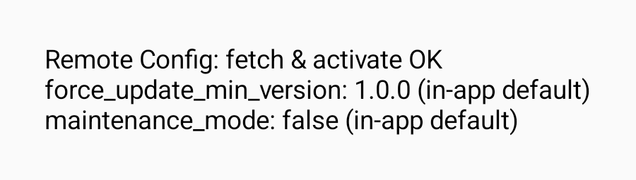

# Báo cáo Chi tiết Observability, Remote Config và CI/CD Release (Cập nhật Nhánh `kan-102`)

## Đã thực hiện

- **Crashlytics:** Nhận UID phiên Supabase (`setUserId`) và vai trò (`user_role`) khi hồ sơ được tải; xóa danh tính (`CrashIdentity.clear()`) khi đăng xuất, phiên hết hạn hoặc ứng dụng khởi động lại.
- **Remote Config:** Dùng mặc định `force_update_min_version = "1.0.0"` và `maintenance_mode = false`. Ứng dụng đọc cấu hình đã kích hoạt, sau đó gọi `fetchAndActivate` khi vào foreground. Nếu mạng lỗi, cấu hình mặc định vẫn được áp dụng an toàn.
- **Quy tắc bảo trì & cập nhật:** Màn bảo trì (`MAINTENANCE`) ưu tiên hơn màn cập nhật (`UPDATE_REQUIRED`). So sánh phiên bản theo từng thành phần số (ví dụ `1.10.0` lớn hơn `1.9.0`).
- **An toàn File Credentials:** Loại trừ 100% file `google-services.json` khỏi Git qua `app/.gitignore`, tránh lộ thông tin bảo mật trên GitHub.
- **Workflow CI/CD Release:** File `android-release.yml` đọc `GOOGLE_SERVICES_JSON` từ GitHub Secrets, kiểm tra package Android `com.giathinh.uthconnect` và project ID với GitHub variable `FIREBASE_PROJECT_ID`, rồi tạo APK Release. Workflow tự động ký và xác minh trước khi upload artifact.
- **Tối ưu Git Branch:** Khởi tạo nhánh mới **`kan-102`** từ `origin/main` mới nhất, xóa bỏ các commit rác cũ để tránh xung đột khi merge.

## Kết quả kiểm tra tại máy

- **Unit test Android:** 215 unit test thành công không lỗi, bao gồm test áp dụng cấu hình mới mô phỏng và giữ trạng thái đã kích hoạt khi fetch thất bại.
- **Build Release APK:** Biên dịch `assembleRelease` cục bộ thành công.
- **Inject Script Test:** Các test của script CI kiểm tra cấu hình Firebase hợp lệ, thiếu/sai dữ liệu, sai project hoặc sai package đều thành công.
- **Giao diện Bảo trì / Cập nhật:** Các màn hình hiển thị chính xác theo trạng thái cờ Remote Config.

## Hướng dẫn Hoàn tất Cấu hình GitHub Actions

Để workflow tự động build và ký APK Release thành công 100% trên GitHub Runner:
1. Vào Repository GitHub ➔ **Settings** ➔ **Secrets and variables** ➔ **Actions**.
2. **Secrets:** `GOOGLE_SERVICES_JSON`, `SUPABASE_URL`, `SUPABASE_PUBLISHABLE_KEY`, `GOOGLE_WEB_CLIENT_ID`, `ANDROID_KEYSTORE_BASE64`, `ANDROID_KEYSTORE_PASSWORD`, `ANDROID_KEY_ALIAS`, `ANDROID_KEY_PASSWORD`.
3. **Variables:** `FIREBASE_PROJECT_ID`.
4. Mở Pull Request từ nhánh **`kan-102`** vào **`main`**.
