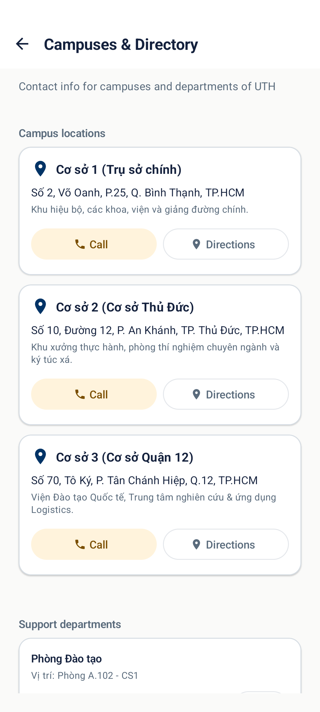
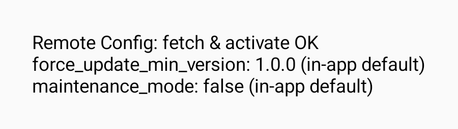
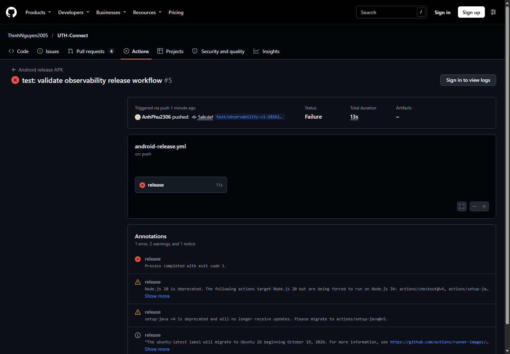

# Báo cáo công việc ngày 09/11/2026

**Dự án:** UTH Connect — Android  
**Phạm vi:** Danh bạ cơ sở, kiểm thử ứng dụng và cấu hình giám sát vận hành.

## 1. Danh bạ cơ sở và chỉ đường

### Yêu cầu

- Xử lý trường hợp thiết bị không có ứng dụng nhận URI `geo:` khi người dùng bấm **Chỉ đường**; hiển thị thông báo bằng tiếng Việt và tiếng Anh.
- Bổ sung instrumentation test mô phỏng `ActivityNotFoundException`.
- Bỏ chú thích “Nguyễn Văn Thương cũ” khỏi địa chỉ Cơ sở 1 và cập nhật assertion địa chỉ.

### Kết quả thực hiện

- Đã bắt `ActivityNotFoundException`, hiển thị thông báo phù hợp và thêm test cho trường hợp có hoặc không có ứng dụng bản đồ.
- Địa chỉ Cơ sở 1 hiện là **Số 2, Võ Oanh, P.25, Q. Bình Thạnh, TP.HCM**.
- Đã xử lý thêm tình huống thiết bị không có ứng dụng gọi điện, với thông báo Việt/Anh và test tương ứng.
- Đã chuyển commit **`c849aa4`** lên GitHub, nhánh **`feature/KAN-95-main`**. Khi chuyển, giữ mã đăng nhập và hồ sơ sẵn có của nhánh đích.

### Kiểm thử và bằng chứng

- Trên nền mã ban đầu: 142 unit test đạt; 32 instrumentation test đạt trên Android emulator, bao gồm ba test cho chỉ đường và gọi điện. Lint đạt trên nền mã đó.
- Sau khi chuyển sang nhánh `feature/KAN-95-main`, chưa xác nhận lại toàn bộ test của nhánh đối với riêng commit Cơ sở; lần thử đầu thiếu plugin trong cache. Các bước build và unit test của nhánh sau đó đã được thực hiện cùng phần giám sát ở mục 2.
- Ảnh dưới đây được chụp bằng instrumentation test trên **nền mã ban đầu**, để minh họa địa chỉ và nút chỉ đường; giao diện của nhánh đích có thể khác.

## 2. Giám sát vận hành: Crashlytics và Remote Config

### Yêu cầu

- Gắn UID Supabase và `user_role` vào Firebase Crashlytics khi phiên hợp lệ được đăng nhập hoặc khôi phục.
- Thiết lập mặc định `force_update_min_version = "1.0.0"` và `maintenance_mode = false`; chặn ứng dụng khi cần cập nhật hoặc bảo trì.
- Đảm bảo build Release trên GitHub Actions nhận đúng `google-services.json` và kiểm tra ba tiêu chí nghiệm thu trên Firebase Console, Remote Config và GitHub Actions.

### Kết quả thực hiện

- Đã thêm mã gắn UID khi tạo phiên Supabase và gắn vai trò khi tải hồ sơ; xóa danh tính Crashlytics khi đăng xuất, phiên hết hạn hoặc khởi động lại ứng dụng.
- Đã thêm hai giá trị mặc định, xử lý `fetchAndActivate`, màn hình bảo trì và màn hình yêu cầu cập nhật. Nếu cả hai điều kiện cùng bật, màn bảo trì được ưu tiên.
- Đã thêm workflow Release độc lập: lấy cấu hình Firebase từ GitHub Secrets, kiểm tra project ID và package, build, ký và xác minh APK trước khi lưu artifact. Ticket KAN-101 đang thực hiện; workflow mới chưa được chứng minh là đã tích hợp với workflow KAN-101 thực tế.
- Đã đưa một bản kiểm thử lên nhánh riêng `test/observability-ci-20261109` (commit `5a6cdef`) để chạy GitHub Actions. Các thay đổi trong workspace của nhánh `feature/KAN-95-main` vẫn chưa commit; chưa merge nhánh kiểm thử.

### Kiểm thử tại máy

| Nội dung | Kết quả | Phạm vi xác nhận |
| --- | --- | --- |
| Unit test Android | 215 test đạt | Bao gồm test áp dụng cấu hình mới mô phỏng và giữ trạng thái đã kích hoạt khi fetch thất bại. |
| Giao diện bảo trì và cập nhật | 2 instrumentation test đạt | Màn hình được test bằng trạng thái mô phỏng trên emulator. |
| Remote Config | 1 instrumentation test đạt | `fetchAndActivate` thành công; cả hai cờ đang có nguồn **in-app default**. |
| Script kiểm tra cấu hình CI | 3 test đạt | Kiểm tra đúng/sai project, package, dữ liệu thiếu hoặc không hợp lệ. |
| APK Release | Build tại máy thành công | Đã thử cấu hình Supabase giả lập; APK chưa ký, không dùng để phân phối. |
| Ký APK | Ký và `apksigner verify` thành công | Dùng keystore kiểm thử tạm thời; chưa kiểm chứng keystore GitHub thực tế. |
| GitHub Actions | Chạy thật, thất bại tại bước inject Firebase | Run #5 thiếu `GOOGLE_SERVICES_JSON` và `FIREBASE_PROJECT_ID`; bước build/ký APK chưa chạy. |
| Lint debug toàn dự án | Thất bại: 18 lỗi | Gồm lỗi QR, bản dịch, Compose và `local.properties`; không thể coi lint toàn nhánh đã đạt. |

[Xem GitHub Actions run #5](https://github.com/ThinhNguyen2005/UTH-Connect/actions/runs/42579449766)

### Tiêu chí chưa xác nhận

1. Chưa kiểm tra lỗi có Supabase UID và `user_role` chính xác trên Firebase Crashlytics Console bằng tài khoản thử nghiệm.
2. Chưa xuất bản giá trị Remote Config mới và xác nhận app nhận giá trị đó; kết quả hiện tại chỉ chứng minh fetch thành công và app dùng mặc định.
3. Workflow đã chạy trên GitHub nhưng thất bại do thiếu secret/variable Firebase. Cần cấu hình đầy đủ secrets, variable và keystore rồi chạy lại; chưa có artifact Release.
4. Phiên Supabase hiện chỉ được giữ trong bộ nhớ; app chưa có cơ chế khôi phục phiên sau khi đóng, nên chưa kiểm thử được nhánh khôi phục phiên.

Chi tiết cấu hình secrets và trạng thái nghiệm thu xem tại [báo cáo Crashlytics và Remote Config](BAO_CAO_CHI_TIET_OBSERVABILITY.md).

## 3. Công việc tiếp theo

- Kết nối dự án Firebase và chuẩn bị tài khoản Supabase kiểm thử; xác nhận UID và vai trò trên Crashlytics Console.
- Xuất bản cấu hình thử nghiệm có kiểm soát, sau đó xác nhận app nhận giá trị mới và khôi phục cấu hình mong muốn.
- Phối hợp với công việc KAN-101, cấu hình GitHub Secrets/variable theo báo cáo chi tiết và chạy workflow Release thực tế.
- Thiết kế lưu và khôi phục phiên Supabase an toàn trước khi kiểm thử tiêu chí về phiên được khôi phục.

[Hướng dẫn cấu hình và hoàn tất nghiệm thu](HUONG_DAN_HOAN_TAT.md)
