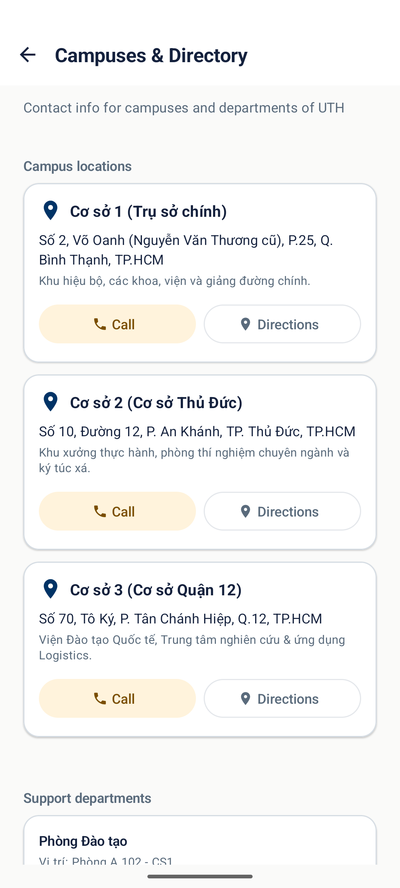
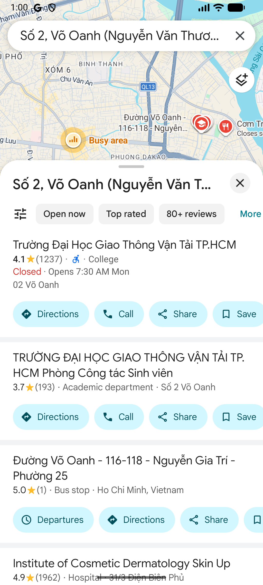
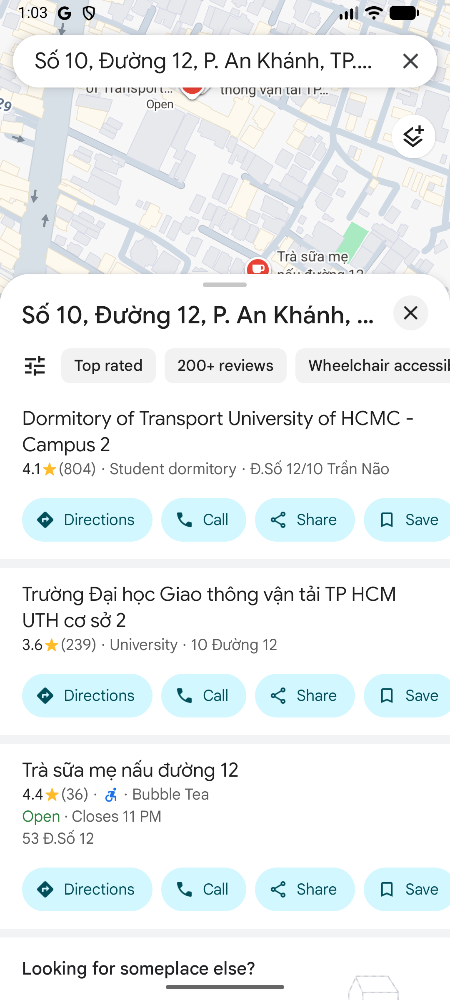
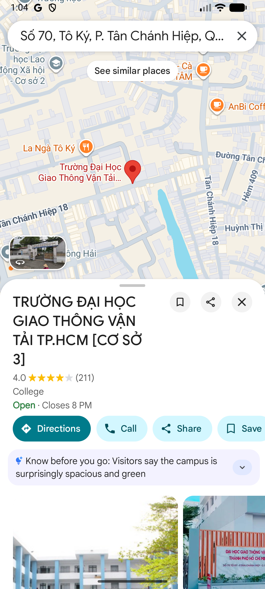
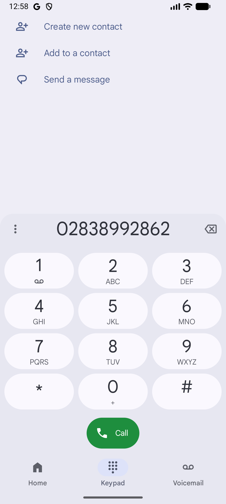
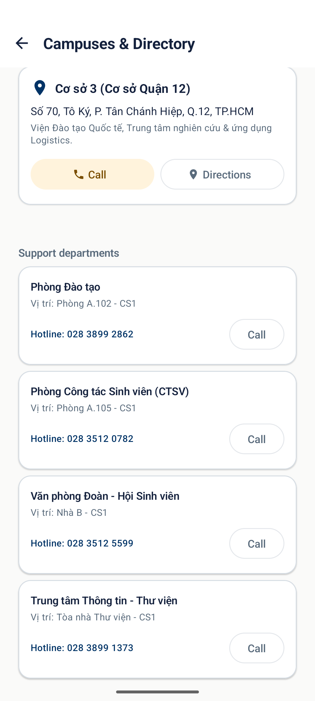
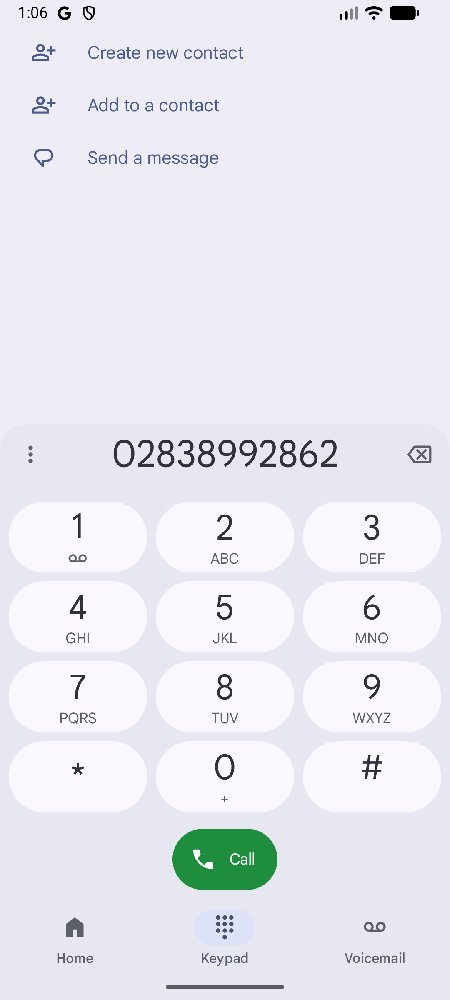
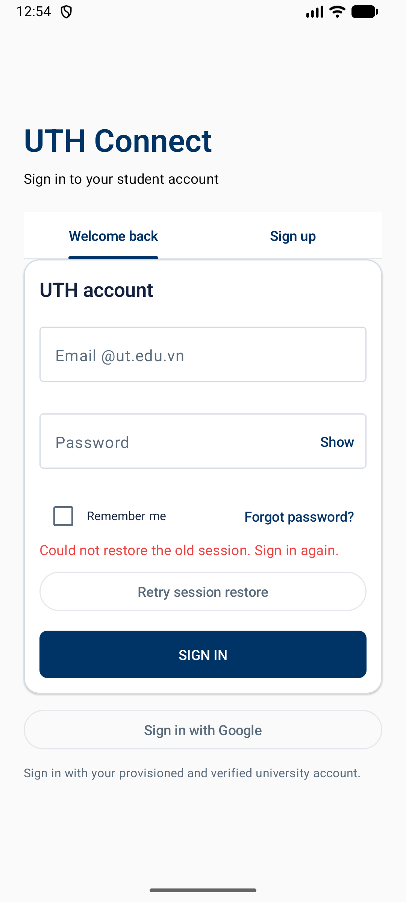

# Báo cáo kiểm tra CAMPUS-DIRECTORY

**Ngày chạy:** 07/11/2026  
**Nhánh:** `feature/KAN-95-main`, tạo từ `origin/main` (`c73d548`)  
**Thiết bị:** Android Emulator `Medium_Phone_API_37.0`  
**Phạm vi:** địa chỉ 3 cơ sở, intent chỉ đường/gọi điện, kiểm tra mã nguồn và bộ kiểm tra tự động.

## Kết quả

| Kiểm tra | Kết quả | Ghi chú/bằng chứng |
|---|---|---|
| Địa chỉ cơ sở 1 | PASS | `Số 2, Võ Oanh (Nguyễn Văn Thương cũ), P.25, Q. Bình Thạnh, TP.HCM`; assertion unit test. |
| Địa chỉ cơ sở 2 | PASS | `Số 10, Đường 12, P. An Khánh, TP. Thủ Đức, TP.HCM`; assertion unit test. |
| Địa chỉ cơ sở 3 | PASS | `Số 70, Tô Ký, P. Tân Chánh Hiệp, Q.12, TP.HCM`; assertion unit test. |
| Mở chỉ đường | PASS | Component instrumentation test xác nhận `ACTION_VIEW` với URI `geo:` có địa chỉ cơ sở 1. Ảnh Maps cho cả ba cơ sở được lưu bên dưới, chụp từ lượt kiểm tra UI harness trước đó. |
| Gọi hotline cơ sở | PASS | Component instrumentation test xác nhận `ACTION_DIAL` với URI `tel:` và số hotline. Ảnh dialer có trong folder. |
| Danh bạ phòng ban/gọi phòng ban | PASS trong ảnh UI harness trước đó | `13-department-directory.png`, `16-department-call-result.png`. |
| Route production qua Tiện ích | CHƯA XÁC NHẬN | Route đã được rà mã nguồn; không thể xác nhận bằng thao tác app sau đăng nhập trong lượt này do môi trường thiếu cấu hình backend/session test. Ảnh `07-fresh-uthconnect.png` ghi nhận app bị chặn tại cổng đăng nhập. |
| `detekt spotlessCheck :app:assembleDebug :app:testDebugUnitTest` | PASS | `BUILD SUCCESSFUL`; unit tests: 210 tổng, 1 skipped, 0 failure/error. |
| `:app:connectedDebugAndroidTest` | PASS | 13 tests trên `Medium_Phone_API_37.0`, 0 skipped/failed. Bao gồm kiểm tra intent Campus và các bài instrumentation hiện có. |
| `git diff --check` | PASS | Không có whitespace error. |

## Bằng chứng ảnh

Ảnh dưới đây là ảnh emulator từ UI harness của lượt kiểm tra trước; chúng minh họa màn Campus và kết quả Maps/Dialer. Harness không đi qua route production và ảnh màn Campus được chụp trước các chỉnh sửa UI cuối của nhánh này. Bằng chứng kiểm tra mã cuối cùng là unit/instrumentation results nêu trên.

### Màn Campus và điều hướng

### Gọi điện và danh bạ

### Trạng thái app production

## Giới hạn và việc còn lại

- Chưa xác nhận đường đi UI production từ Tiện ích tới Campus sau đăng nhập do không có cấu hình backend/session test phù hợp trong môi trường chạy. Không ghi thông tin đăng nhập, mật khẩu hoặc token vào báo cáo.
- Ảnh Maps/Dialer là bằng chứng UI harness đã chụp trước khi cập nhật nhánh mới; instrumentation hiện tại xác nhận intent ở cấp component. Cần chạy lại thao tác qua app production khi có môi trường/tài khoản phù hợp.
- Không tuyên bố Definition of Done tổng thể đã hoàn tất: PR mới cần reviewer phê duyệt, và route production cần được xác nhận nếu tiêu chí yêu cầu thao tác end-to-end trên app.

## Tệp ảnh

`01-app-auth-gate.png`, `01-app-auth-gate.xml`, `02-app-running.png`, `03-session-retry.png`, `04-after-test-rerun.png`, `07-fresh-uthconnect.png`, `08-campus-screen-manual-harness.png`, `09-call-button-result.png`, `10-directions-button-result.png`, `11-directions-campus-2.png`, `12-directions-campus-3.png`, `13-department-directory.png`, `16-department-call-result.png`.
