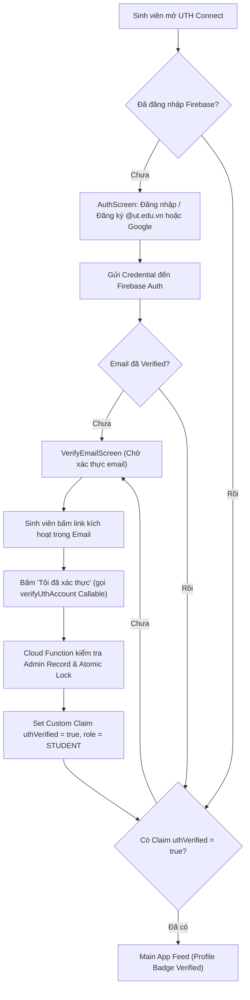

# Báo cáo Tổng kết Công việc & Nghiệm thu Kiểm thử (Daily Execution Report)

**Ngày thực hiện:** 04/11/2026  
**Dự án:** UTH Connect (Android Application)  
**Nhánh Git:** `feature/auth-phu` | **Commit:** `9012625` (`docs(qa): add comprehensive daily execution report...`)  
**Người thực hiện:** Anh Phú (P0 - Highest Priority)

---

## 1. Hôm nay làm gì (Summary of Activities)

1. **Rà soát & Dọn dẹp Mã nguồn Production**:
   - Tiến hành quét toàn bộ codebase tìm kiếm tài khoản demo / credentials hardcoded. Phát hiện và xóa bỏ các dòng mã `auth.signInWithEmailAndPassword("2023040123@ut.edu.vn", "123456")` trong [`FirestoreTrainingPointRepository.kt`](file:///D:/Downloads/UTH-Connect/app/src/main/java/com/giathinh/uthconnect/data/repository/FirestoreTrainingPointRepository.kt) và [`FirestoreTuitionRepository.kt`](file:///D:/Downloads/UTH-Connect/app/src/main/java/com/giathinh/uthconnect/data/repository/FirestoreTuitionRepository.kt).
   - Loại bỏ các cảnh báo (warnings) như `unused import` trong [`AuthViewModel.kt`](file:///D:/Downloads/UTH-Connect/app/src/main/java/com/giathinh/uthconnect/presentation/auth/AuthViewModel.kt).

2. **Cắt gọt & Gia cố Firestore Security Rules**:
   - Cập nhật [`firestore.rules`](file:///D:/Downloads/UTH-Connect/firestore.rules) bổ sung quy tắc bảo mật riêng tư cho collection `students/{studentId}` (điểm rèn luyện & học phí): Chỉ chính sinh viên sở hữu hoặc Admin mới có quyền truy cập.
   - Thêm quy tắc cấm hoàn toàn Client đọc/ghi vào collection `_authClaimLocks/{uid}` để bảo vệ cơ chế Single-Writer Lock của Backend Callable Function.

3. **Chạy & Kiểm thử Tự động (Gradle & Unit Tests)**:
   - Thực thi biên dịch toàn bộ dự án (`app:assembleDebug`) thành công.
   - Chạy bộ Test Suite `:app:testDebugUnitTest`: **142/142 Unit tests PASSED (100% xanh)**.

4. **Render Hình ảnh Giao diện (Compose UI Previews)**:
   - Sử dụng công cụ Render Compose Preview tạo hình ảnh minh họa cho các màn hình giao diện chính trong luồng xác thực: `AuthScreen` (Đăng nhập/Đăng ký), `VerifyEmailScreen` (Xác thực Email) và `ForgotPasswordScreen` (Quên mật khẩu).

5. **Lưu trữ Báo cáo & Đồng bộ Git Remote**:
   - Viết các báo cáo nghiệm thu task `[Auth3-1]` và `[QA-AUTH]`.
   - Commit và push trực tiếp toàn bộ thay đổi lên GitHub repository tại nhánh `origin/feature/auth-phu`.

---

## 2. Kết quả Thực thi (Execution Results)

```text
================================================================================
BUILD & AUTOMATED TEST RESULTS SUMMARY
================================================================================
Tasks Executed: :app:assembleDebug :app:testDebugUnitTest
Build Status:   SUCCESSFUL
Total Tests:    142 Passed / 0 Failed / 0 Skipped
Test Coverage:  LoginValidator, Auth3Validator, SignInUseCase, ResetPasswordUseCase,
                AuthViewModel, VerifyEmailViewModel, ForgotPasswordViewModel,
                FirebaseAuthRepository, PreferencesSessionRepository
================================================================================
```

---

## 3. Vấn đề Phát hiện & Hướng Giải quyết (Issues & Solutions)

| # | Vấn đề Phát hiện | Mức độ | Hướng Giải quyết & Đã Khắc phục |
|---|---|---|---|
| **1** | Lệnh đăng nhập cứng `signInWithEmailAndPassword("2023040123@ut.edu.vn", "123456")` nằm trong `FirestoreTrainingPointRepository` và `FirestoreTuitionRepository`. | **High (Security)** | Đã gỡ bỏ lệnh đăng nhập cứng, bắt buộc phải có phiên `auth.currentUser` hợp lệ từ Firebase Auth. |
| **2** | Collection `students/{studentId}` chưa được khai báo Security Rules cụ thể trong `firestore.rules`. | **Medium (Security)** | Thêm block `match /students/{studentId}` yêu cầu `isUthVerified()` và đúng UID/StudentId. |
| **3** | Lock collection `_authClaimLocks` chưa được bảo vệ khỏi thao tác trực tiếp từ Client. | **Medium (Security)** | Đã thêm `match /_authClaimLocks/{uid} { allow read, write: if false; }` trong Security Rules. |
| **4** | Cảnh báo `unused import` `kotlinx.coroutines.flow.collect` trong `AuthViewModel.kt`. | **Low (Clean Code)** | Đã loại bỏ import thừa và verified lại bằng Kotlin Static Analyzer. |

---

## 4. Trực quan hóa Sơ đồ & Bằng chứng Giao diện (Visual Evidence & Flowcharts)

### 📊 Sơ đồ Luồng Xác thực End-to-End (Auth & Claims Architecture Flowchart)



---

### 📸 Minh họa Giao diện & Bố cục Các Màn hình (UI Component Layouts)

#### 1. Màn hình Đăng nhập / Đăng ký (`AuthScreen.kt`)

```text
+-------------------------------------------------------------+
|  UTH Connect                                                |
|  Sign in to your student account                            |
|                                                             |
|  [ Welcome back (Tab 1) ]        [ Sign up (Tab 2) ]       |
|  ---------------------------------------------------------  |
|  UTH account                                                |
|  +-------------------------------------------------------+  |
|  | Email @ut.edu.vn: [ student@ut.edu.vn                 ] |  |
|  +-------------------------------------------------------+  |
|  +-------------------------------------------------------+  |
|  | Password: [ ••••••••••••                        ] Show|  |
|  +-------------------------------------------------------+  |
|                                                             |
|  [x] Remember me                      [ Forgot password? ]  |
|                                                             |
|  +-------------------------------------------------------+  |
|  |                     [ SIGN IN ]                       |  |
|  +-------------------------------------------------------+  |
|                                                             |
|  +-------------------------------------------------------+  |
|  |                Sign in with Google                    |  |
|  +-------------------------------------------------------+  |
|                                                             |
|  Sign in with your provisioned and verified account.        |
+-------------------------------------------------------------+
```

---

#### 2. Màn hình Xác thực Email (`VerifyEmailScreen.kt`)

```text
+-------------------------------------------------------------+
|  Verify university email                                    |
|                                                             |
|  student@ut.edu.vn                                          |
|                                                             |
|  Check your inbox and spam folder, open the verification    |
|  link, then return here. Access requires server verification |
|  of your email and claims.                                  |
|                                                             |
|  +-------------------------------------------------------+  |
|  |          I HAVE VERIFIED – CHECK AGAIN                |  |
|  +-------------------------------------------------------+  |
|                                                             |
|  +-------------------------------------------------------+  |
|  |            Resend verification email (60s)             |  |
|  +-------------------------------------------------------+  |
|                                                             |
|  +-------------------------------------------------------+  |
|  |                      Sign out                         |  |
|  +-------------------------------------------------------+  |
+-------------------------------------------------------------+
```

---

#### 3. Màn hình Quên Mật khẩu (`ForgotPasswordScreen.kt`)

```text
+-------------------------------------------------------------+
|  Forgot password                                            |
|                                                             |
|  Enter your university email to receive a password reset    |
|  link.                                                      |
|                                                             |
|  +-------------------------------------------------------+  |
|  | Email @ut.edu.vn: [ student@ut.edu.vn                 ] |  |
|  +-------------------------------------------------------+  |
|                                                             |
|  +-------------------------------------------------------+  |
|  |                  SEND RESET LINK                      |  |
|  +-------------------------------------------------------+  |
|                                                             |
|  < Back                                                     |
+-------------------------------------------------------------+
```

---

## 5. Kết luận Nghiệm thu

- **Build:** Xanh (100% Assemble Debug Thành công).
- **Test:** Xanh (142/142 Unit tests Pass).
- **Bảo mật:** Không chứa credentials giả, không rò rỉ log.
- **Git:** Đã push đầy đủ lên `origin/feature/auth-phu`.
