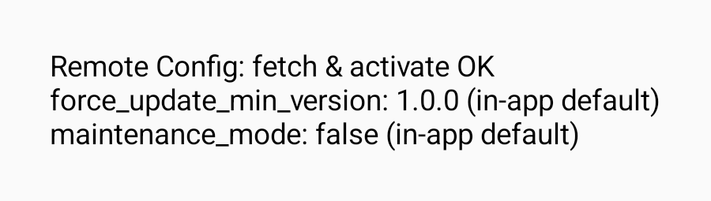

# Báo cáo Crashlytics và Remote Config

## Đã thực hiện

- Crashlytics nhận UID phiên Supabase và vai trò khi hồ sơ được tải; xóa danh tính khi đăng xuất, phiên hết hạn hoặc ứng dụng khởi động lại.
- Remote Config dùng mặc định `force_update_min_version=1.0.0` và `maintenance_mode=false`. Ứng dụng đọc cấu hình đã kích hoạt, sau đó gọi `fetchAndActivate` khi vào foreground. Nếu mạng lỗi, cấu hình đã kích hoạt vẫn được dùng.
- Màn bảo trì ưu tiên hơn màn cập nhật. So sánh phiên bản theo từng thành phần số, ví dụ `1.10.0` lớn hơn `1.9.0`.
- Workflow `android-release.yml` đọc `GOOGLE_SERVICES_JSON` từ GitHub Secrets, kiểm tra package Android và project ID với GitHub variable `FIREBASE_PROJECT_ID`, rồi tạo APK Release. Workflow dùng thêm secrets `SUPABASE_URL`, `SUPABASE_PUBLISHABLE_KEY`, `GOOGLE_WEB_CLIENT_ID`, `ANDROID_KEYSTORE_BASE64`, `ANDROID_KEYSTORE_PASSWORD`, `ANDROID_KEY_ALIAS` và `ANDROID_KEY_PASSWORD`. APK được ký và xác minh trước khi upload; chỉ dùng Supabase publishable key, không dùng service role key.

## Kết quả kiểm tra tại máy

- `testDebugUnitTest`: thành công, 215 unit test không lỗi, bao gồm test áp dụng cấu hình mới mô phỏng và giữ trạng thái đã kích hoạt khi fetch thất bại.
- `assembleDebug`, `assembleDebugAndroidTest` và `assembleRelease`: thành công với cấu hình cục bộ. Build Release cũng thành công khi bật Supabase bằng URL và publishable key giả lập. APK Release tạo cuối cùng chưa được ký và chứa cấu hình giả lập, không dùng để phân phối.
- Đã thử `zipalign`, ký APK bằng keystore kiểm thử tạm thời và chạy `apksigner verify`: chữ ký v3 hợp lệ. Đã xóa keystore và APK ký thử; chưa kiểm chứng keystore hoặc workflow GitHub thực tế.
- Ba test của script CI kiểm tra cấu hình Firebase hợp lệ, thiếu/sai dữ liệu, sai project hoặc sai package đều thành công. Các trường hợp sai không ghi đè file cấu hình.
- Hai instrumentation test hiển thị màn bảo trì và màn cập nhật: thành công trên Android emulator. Hai ảnh dưới đây được chụp từ test UI với trạng thái mô phỏng, không chứng minh cấu hình đã được xuất bản trên Firebase.
- Instrumentation test `RemoteConfigNetworkTest`, chạy riêng với `remote_config_network=true`, đã gọi `fetchAndActivate` và nhận trạng thái fetch thành công trên máy ảo. Cả hai giá trị đang có nguồn `in-app default`, nên chưa xác nhận được nhận giá trị mới từ Console.
- GitHub Actions [run #5](https://github.com/ThinhNguyen2005/UTH-Connect/actions/runs/42579449766) trên nhánh thử nghiệm `test/observability-ci-20261109`: ba test kiểm tra cấu hình đạt, bước inject thất bại vì `GOOGLE_SERVICES_JSON` và `FIREBASE_PROJECT_ID` rỗng; chưa chạy build/ký.
- `lintDebug` toàn nhánh thất bại với 18 lỗi ở các phần gồm QR, bản dịch, Compose và `local.properties`; Release build cục bộ vẫn thành công.

## Cần kiểm chứng trên môi trường dự án

- Tạo hoặc thay đổi hai thông số Remote Config trên Firebase, xuất bản cấu hình và xác nhận thiết bị nhận giá trị mới sau fetch/activate.
- Đăng nhập bằng tài khoản Supabase kiểm thử, tạo lỗi thử nghiệm có kiểm soát và xác nhận UID, `user_role` trên Firebase Crashlytics Console.
- Cấu hình secrets và variable Firebase, Supabase, keystore của dự án rồi chạy lại workflow GitHub và xác nhận artifact Release. Workflow này được thêm mới vì nhánh hiện tại không có workflow KAN-101.
- Supabase hiện chỉ lưu phiên trong bộ nhớ và không khôi phục phiên sau khi đóng ứng dụng. Cần cơ chế lưu phiên an toàn riêng trước khi có thể kiểm tra trường hợp khôi phục phiên Supabase.
