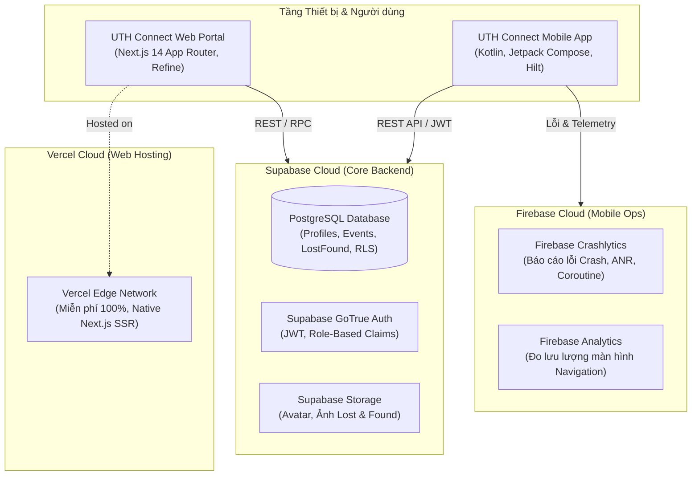

# Kế hoạch Kiến trúc & Triển khai Toàn diện: Observability, Media & Web Deployment — UTH Connect

> **Mã tài liệu:** `PLAN-2026-ARCH-01`  
> **Phiên bản:** 2.0 (Đã hoàn thiện sau phân tích & đối chiếu thực tế)  
> **Ngày cập nhật:** 08/11/2026  
> **Trạng thái:** Đã thống nhất quyết định kiến trúc (Ready for Phase 1 Execution)  
> **Phạm vi:** Android App (`app/`), Web Portal (`web/`), Dữ liệu (`Supabase`), Giám sát (`Firebase`), Triển khai (`Vercel`)

---

## 1. Bối cảnh & Tầm nhìn Kiến trúc Lai (Hybrid Architecture)

Hệ thống **UTH Connect** được định hình theo mô hình kiến trúc lai hiện đại:
* **Supabase Cloud (PostgreSQL, GoTrue Auth, Storage)**: Đóng vai trò là "Trái tim dữ liệu" và quản lý phân quyền (RBAC/RLS) cho sinh viên, giảng viên và quản trị viên.
* **Firebase (Google Mobile Services)**: Đảm nhận hạ tầng vận hành di động chuẩn mực (Mobile Ops) gồm báo cáo lỗi chuyên sâu (Crashlytics) và phân tích hành vi (Analytics).
* **Vercel Cloud**: Hạ tầng lưu trữ và phân phối Web Portal & Admin Dashboard đa phân quyền cho ban tổ chức và ban giám hiệu với chi phí 0đ và hỗ trợ toàn diện Next.js 14 SSR.



---

## 2. Bảng Quyết định Công nghệ & Xác định Phạm vi (Architectural Guardrails)

Dưới đây là các quyết định kỹ thuật đã được cân nhắc kỹ lưỡng giữa lý thuyết và tính khả thi trên mã nguồn thực tế:

| Phân hệ / Tính năng | Giải pháp Lựa chọn | Giải pháp Bị Loại trừ | Lý do Lựa chọn & Đánh giá Rủi ro |
| :--- | :--- | :--- | :--- |
| **Lưu trữ Media (Ảnh)** | **Supabase Storage + Nén WebP Client-side** | Cloudflare R2 | Cloudflare R2 dù miễn phí băng thông nhưng **bắt buộc phải add thẻ Visa/Mastercard** để kích hoạt bucket. Chọn Supabase Storage (1 GB có sẵn) kết hợp nén ảnh WebP xuống ~100 KB giúp chứa được >10.000 ảnh mà không cần thẻ tín dụng. |
| **Hiển thị Ảnh Android** | **Coil 3 Compose** (`io.coil-kt.coil3`) | Glide / Picasso | Thư viện Coil được viết 100% bằng Kotlin Coroutines, tối ưu tuyệt đối cho Jetpack Compose và có sẵn Disk/Memory Cache để bảo vệ hạn mức 5 GB băng thông của Supabase. |
| **Điểm danh & Soát vé** | **Smart Polling / Pull-to-refresh** | Supabase Realtime (WebSocket) | [`SupabaseRestClient.kt`](file:///d:/APP/UTH-Connect/app/src/main/java/com/giathinh/uthconnect/data/repository/SupabaseRestClient.kt) là HTTP REST Client thuần. Kéo thêm WebSocket engine sẽ làm phình APK, nhanh chóng cạn kiệt 200 connection pool của Supabase Free và làm nóng máy, tốn pin sinh viên. |
| **Thông báo (Notifications)** | **In-App Notifications (Bảng thông báo)** | Deep Link FCM Type-Safe | Tạm hoãn Push Notifications (FCM) để tập trung hoàn thiện tính năng cốt lõi. Bỏ qua luồng mapping Deep Link phức tạp vào Navigation. Chừa sẵn kiến trúc bảng `user_fcm_tokens` để tích hợp sau. |
| **Báo cáo sự cố** | **Firebase Crashlytics + Timber** | Tự ghi log vào DB | Crashlytics là công cụ miễn phí mạnh nhất trên Android, tự động giải mã ProGuard/R8, gom nhóm lỗi theo dòng code và thiết bị. |
| **Triển khai Web** | **Vercel** | Firebase App Hosting | Firebase App Hosting yêu cầu nâng cấp gói trả phí Blaze (cần thẻ Visa). Vercel miễn phí vĩnh viễn, triển khai từ GitHub chỉ trong 1 click và hỗ trợ SSR mượt mà. |

---

## 3. Thiết kế Kiến trúc Chi tiết từng Phân hệ

### 3.1. Phân hệ Giám sát & Báo cáo lỗi (Observability Layer)
* **Nguyên tắc Zero-PII**: Tuyệt đối không gửi MSSV, email, mật khẩu lên Crashlytics/Analytics.
* **Liên kết danh tính an toàn**: Trong [`SupabaseAuthRepository.kt`](file:///d:/APP/UTH-Connect/app/src/main/java/com/giathinh/uthconnect/data/repository/SupabaseAuthRepository.kt), khi đăng nhập thành công chỉ ánh xạ mã UUID vô danh:
  ```kotlin
  crashReporter.setUserId(client.userId) // client.userId là UUID của Supabase
  crashReporter.setCustomKey("user_role", profile.role.name)
  ```
* **Phân tầng Clean Architecture (`com.giathinh.uthconnect.core.telemetry`)**:
  * `AnalyticsTracker`: Interface theo dõi màn hình navigation và hành động nghiệp vụ.
  * `CrashReporter`: Interface ghi nhận exception và log hệ thống.
  * `TelemetryModule`: Cung cấp Hilt binding Singleton (tách biệt hoàn toàn SDK Firebase khỏi ViewModel).
* **Cấu hình Timber Logging Tree trong [`UTHConnectApplication.kt`](file:///d:/APP/UTH-Connect/app/src/main/java/com/giathinh/uthconnect/UTHConnectApplication.kt)**:
  * Bản `DEBUG`: Chạy `Timber.DebugTree()` in ra Logcat.
  * Bản `RELEASE`: Chạy `CrashlyticsLoggingTree()` tự động chuyển `Timber.e()` và `Timber.w()` về Firebase Crashlytics mà không làm lộ Logcat trên máy người dùng.

### 3.2. Phân hệ Media & Tối ưu hóa Supabase Storage
* **Chiến lược Nén ảnh Client-side (Trước khi Upload)**:
  * Khi sinh viên chụp hoặc chọn ảnh đồ thất lạc:
    1. Downscale cạnh dài nhất về tối đa **1080px hoặc 1280px**.
    2. Nén định dạng **WebP Lossy (Chất lượng 75–80%)**.
    3. File dung lượng từ 4–6 MB sẽ giảm xuống còn **~80 KB – 120 KB**.
* **Hiển thị & Caching qua Coil 3**:
  * Tích hợp `io.coil-kt.coil3:coil-compose:3.6.3` và `io.coil-kt.coil3:coil-network-okhttp:3.6.3`.
  * Bộ nhớ đệm tự động (Disk Cache) trên thiết bị giúp sinh viên xem lại ảnh mà không tốn thêm 1 byte băng thông nào từ Supabase.

### 3.3. Phân hệ Điểm danh Sinh viên (Attendance & Check-in)
* **Cơ chế Smart Polling & Pull-to-refresh**:
  * Màn hình danh sách điểm danh của Ban tổ chức ([`SupabaseAttendanceRosterRepository.kt`](file:///d:/APP/UTH-Connect/app/src/main/java/com/giathinh/uthconnect/data/repository/SupabaseAttendanceRosterRepository.kt)) duy trì cơ chế kéo để làm mới (Pull-to-refresh).
  * Khi quét QR bằng camera, app gửi RPC `check_in_ticket_qr` trực tiếp, phản hồi kết quả tức thì tại chỗ mà không phụ thuộc vào WebSocket.

### 3.4. Phân hệ Thông báo & Chừa đường cho FCM Tương lai
* **Giai đoạn hiện tại (In-App Notifications)**:
  * Sử dụng màn hình Thông báo chung truy vấn dữ liệu từ bảng `notifications` trong Supabase.
* **Điểm nối kiến trúc (Future-Proof Hook)**:
  * Supabase chuẩn bị sẵn bảng `user_fcm_tokens(id, user_id, fcm_token, device_name, updated_at)`.
  * Sau này chỉ cần tạo service kế thừa `FirebaseMessagingService` để hứng token và đẩy vào bảng này mà không làm xáo trộn bất kỳ dòng code UI/Data nào của hệ thống.

### 3.5. Dọn dẹp Mã nguồn & Tránh nhầm lẫn Khái niệm
* Thêm chú thích `@Deprecated` vào [`FirestoreEventRepository.kt`](file:///d:/APP/UTH-Connect/app/src/main/java/com/giathinh/uthconnect/data/repository/FirestoreEventRepository.kt):
  ```kotlin
  @Deprecated(
      message = "Đã chuyển sang dùng SupabaseEventRepository theo kiến trúc Supabase toàn hệ thống.",
      replaceWith = ReplaceWith("SupabaseEventRepository"),
      level = DeprecationLevel.WARNING
  )
  ```
* Bật lại `alias(libs.plugins.google.services)` và thêm `firebase-crashlytics` gradle plugin trong [`app/build.gradle.kts`](file:///d:/APP/UTH-Connect/app/build.gradle.kts).

### 3.6. Quy chuẩn Triển khai Web Portal lên Vercel
* Soạn thảo tài liệu chuẩn [`docs/web/VERCEL_DEPLOYMENT_GUIDE.md`](file:///d:/APP/UTH-Connect/docs/web/VERCEL_DEPLOYMENT_GUIDE.md):
  * Root Directory: `web`.
  * Framework Preset: `Next.js`.
  * Cấu hình biến môi trường: `NEXT_PUBLIC_SUPABASE_URL`, `NEXT_PUBLIC_SUPABASE_ANON_KEY`.

---

## 4. Lộ trình Triển khai 3 Giai đoạn (Phased Implementation Roadmap)

```mermaid
flowchart LR
    subgraph P1["GIAI ĐOẠN 1 (Ưu tiên số 1)"]
        direction TB
        G1["Kích hoạt Google Services\n& Crashlytics Plugin"]
        G2["Xây dựng core.telemetry\n(Analytics & Crashlytics DI)"]
        G3["Timber Tree trong UTHConnectApp"]
        G4["Deprecate FirestoreEventRepository"]
        G5["Tài liệu Vercel Deployment"]
    end

    subgraph P2["GIAI ĐOẠN 2 (Media & Storage)"]
        direction TB
        M1["Thêm Coil 3 vào libs.versions.toml"]
        M2["Tiện ích nén ảnh WebP client-side"]
        M3["Tạo Supabase Storage Bucket & RLS"]
        M4["Cập nhật LostFoundRepository có ảnh"]
    end

    subgraph P3["GIAI ĐOẠN 3 (Engagement Tương lai)"]
        direction TB
        F1["Tạo bảng user_fcm_tokens"]
        F2["Tích hợp Firebase Messaging Service"]
        F3["Edge Function gửi Push Notification"]
    end

    P1 ==> P2 ==> P3
```



---

## 5. Kế hoạch Kiểm chứng Kỹ thuật (Verification Gates)

Trước khi hoàn thành mỗi giai đoạn, hệ thống bắt buộc phải vượt qua các cửa kiểm tra tự động:

```powershell
# 1. Kiểm tra tĩnh phong cách code Kotlin và Compose rules
./gradlew detekt

# 2. Kiểm tra định dạng mã nguồn tự động
./gradlew spotlessCheck

# 3. Chạy toàn bộ Unit Tests của tầng Data và Domain
./gradlew testDebugUnitTest

# 4. Kiểm tra đóng gói build Web Portal
cd web; npm run build; cd ..
```

---
*Tài liệu này là căn cứ kiến trúc thống nhất giữa lập trình viên và trợ lý ảo, tuân thủ tuyệt đối [AGENTS.md](file:///d:/APP/UTH-Connect/AGENTS.md) và tiêu chuẩn Clean Architecture Now in Android.*
