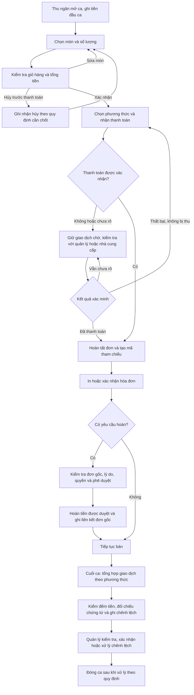

# ERP-24 — Khảo sát quy trình thu ngân căn tin

Trạng thái: **dự thảo chờ TV1 duyệt**, chưa phải kết quả khảo sát hiện trường hay mô tả tính năng đã triển khai. Nguồn: [KAN-146](https://nguyenthinhk52005.atlassian.net/browse/KAN-146), [ERP-05 / KAN-127](https://nguyenthinhk52005.atlassian.net/browse/KAN-127), `docs/srs.md` của main (c3c734c). ERP-05 còn To Do, SRS là bản khởi đầu; các quy tắc dưới đây cần đối chiếu với TV1 và người vận hành.

## Sơ đồ nghiệp vụ đề xuất

Đây là flowchart nghiệp vụ, không khẳng định là BPMN chính thức hoặc phản ánh cấu hình Odoo hiện tại. Chỉ hoàn tất bán khi có xác nhận thanh toán; lỗi in sau thanh toán không được tạo đơn hoặc thu tiền lần nữa. Trạng thái chờ, lưu vết hủy và quyền duyệt là đề xuất cần kiểm chứng trên hệ thống.

## Vai trò và dữ liệu bàn giao

| Vai trò | Trách nhiệm đề xuất |
| --- | --- |
| Thu ngân | Mở ca và ghi tiền đầu ca; chọn/sửa món, kiểm tra tổng; nhận và xác nhận thanh toán; giao hóa đơn; ghi lý do hủy/đề nghị hoàn; kiểm đếm và bàn giao cuối ca. |
| Quản lý ca | Xử lý ngoại lệ, xác minh thanh toán chưa rõ, quyết định yêu cầu hủy/hoàn theo quyền, kiểm tra chênh lệch và xác nhận bàn giao. |
| Khách hàng | Chọn món, thanh toán, nhận hóa đơn và cung cấp thông tin đơn khi yêu cầu hoàn. |

Dữ liệu tối thiểu đề xuất: mã đơn và ca, thời điểm, người thực hiện, món/số lượng/đơn giá, tổng, phương thức và trạng thái thanh toán, tham chiếu thanh toán nếu có; với hoàn/hủy: đơn gốc, lý do, người thực hiện/duyệt, số tiền và thời điểm. Không ghi dữ liệu khách thật trong tài liệu kiểm thử.

## Ngoại lệ và kiểm soát cần xác nhận

| Tình huống | Xử lý đề xuất | Điểm cần TV1/nghiệp vụ chốt |
| --- | --- | --- |
| Hủy giỏ trước khi thu | Dừng đơn, ghi lý do và người thao tác nếu chính sách yêu cầu; không ghi doanh thu. | Có bắt buộc lưu giỏ hủy và cần duyệt không? |
| Hoàn sau thanh toán | Tra đơn gốc, kiểm tra số tiền đã hoàn, lý do và quyền; chỉ ghi hoàn khi đã thực hiện/xác nhận hoàn thực tế. | Điều kiện, thời hạn, hoàn một phần, phương thức và cấp duyệt. |
| Thanh toán thất bại/chưa rõ hoặc mất mạng | Không đánh dấu đã trả khi chưa có xác nhận; đối chiếu tham chiếu trước thử lại để tránh thu trùng. | Nguồn xác nhận, thời gian chờ và quy trình offline. |
| Máy in lỗi sau thanh toán | Giữ trạng thái đơn đã thanh toán; kiểm tra đơn rồi in lại hoặc xác nhận theo quy định; không tạo đơn mới. | Hình thức xác nhận thay thế, quyền in lại. |
| Sai giá/hết món | Dừng xác nhận, sửa giỏ hoặc báo người có quyền; không tự thay giá ngoài phân quyền. | Nguồn giá, cách kiểm tra tồn và quyền sửa giá. |
| Chênh lệch cuối ca | Ghi số đếm, chênh lệch, lý do và chuyển quản lý xem xét; không tự sửa số liệu để khớp. | Ngưỡng, người duyệt, quy trình xử lý và thời điểm đóng ca. |

Đối soát tiền mặt đề xuất: tiền dự kiến = tiền đầu ca + tiền mặt bán thực thu − tiền mặt hoàn thực chi + khoản vào − khoản ra đã được ghi nhận. Chênh lệch = tiền đếm thực tế − tiền dự kiến. Các phương thức không dùng tiền mặt được đối chiếu riêng theo tổng và mã tham chiếu; xác nhận khoản vào/ra và nguồn báo cáo với TV1.

## Kịch bản và nghiệm thu

Năm kịch bản trong [erp-24-scenarios.csv](erp-24-scenarios.csv) là **kỳ vọng đề xuất**, chưa chạy trên Odoo. Xem [hướng dẫn thực thi và phiếu review](erp-24-execution-review.md). TV1 cần duyệt sơ đồ, vai trò, 5 kịch bản và các điểm chưa chốt; ghi người duyệt, ngày và liên kết review tại issue/PR. Sau khi có môi trường POS, thực thi từng kịch bản, lưu kết quả thực tế cùng ảnh/log/video và xử lý lỗi trước Done. Không coi kiểm tra cú pháp CSV là bằng chứng chạy nghiệp vụ.
